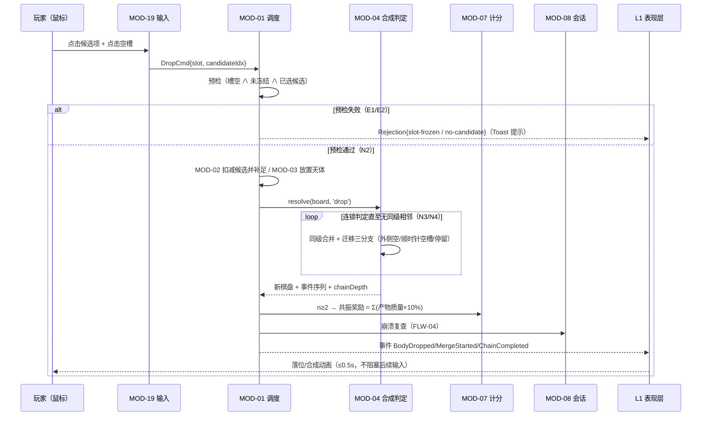
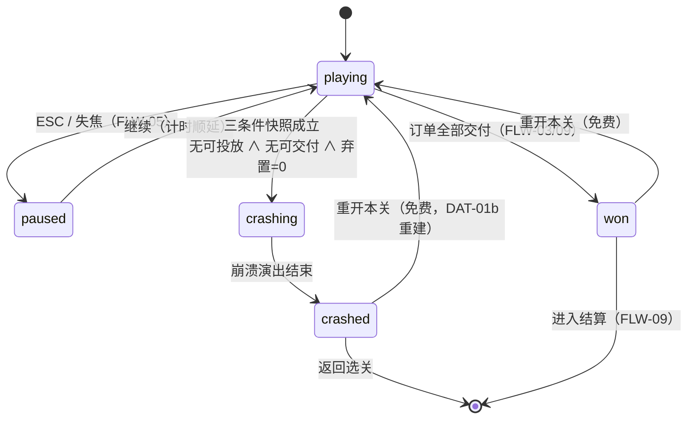
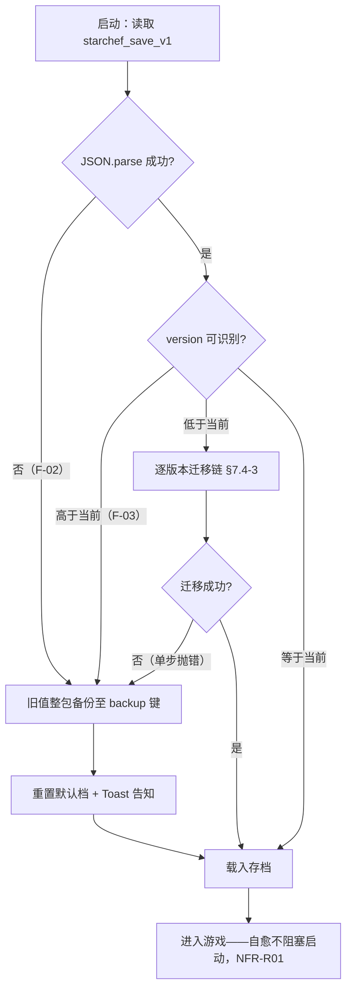
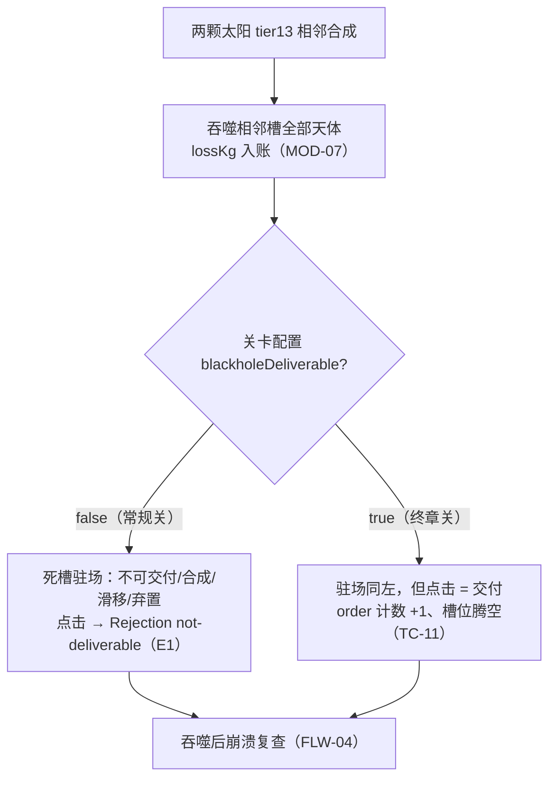

# 《星轨厨房》软件设计文档（架构设计与系统设计）

| 项目名称 | 星轨厨房（天文合成题材网页游戏） |
|---|---|
| 文档版本 | V1.3 |
| 日期 | 2026-10-12 |
| 课程 | 软件工程 课程项目 · 选题一（游戏类）· 实验二（设计文档，个人完成） |
| 提交人 | 余孔鑫 |
| 需求基线 | 《需求分析文档_星轨厨房》V1.3（2026-09-28），51 条 FR / 17 条 NFR 全部沿用，编号一致 |

**版本历史**

| 版本 | 日期 | 说明 | 作者 |
|---|---|---|---|
| V1.0 | 2026-10-12 | 初稿：基于需求基线 V1.3 完成架构、模块、流程、接口、数据、界面、非功能、故障处理、决策权衡、追溯矩阵与测试考虑的完整设计 | 余孔鑫 |
| V1.1 | 2026-10-12 | 对照课程评分标准自检修订：新增模块依赖关系表（§3.2）与架构规模匹配性说明（§3.5）；§5 各流程补"数据与接口落点"；§6.1 增接口总表；§7 修正存档 dex 字段的变体编码、新增文案键值表 DAT-07 与数据-功能-界面对应表（§7.5）；§8.2 U2 要点改为有需求出处的表述；新增 §9.6 约束/假设/外部依赖；§12 补高优先级需求定位自检并同步 DAT 编号；§14.1 增需求编号对照总表（模块级，条数核对 68） | 余孔鑫 |
| V1.2 | 2026-10-12 | 复审修订：§9 各 NFD 关键数值指标改为文内直接复述并括注出处（删除"以需求文档为准"的间接引用）；§7.1 关卡会话运行态编号化为 DAT-01b 并补字段约束表，新增 special/variant/skills 三处枚举口径对照表；新增 FLW-09 通关结算子流程（结算组装/写档触发/海报出口的 N/B/E 路径）；FLW-02 补 mermaid 标准时序图；修正 §13.1 bgStage 笔误；§12.3 开放决策项闭环改为按 FR 编号引用；追溯矩阵与 §14.1 同步补 FLW-09 | 余孔鑫 |
| V1.3 | 2026-10-12 | 复审二轮：§3.2 依赖规则升格为模块依赖有向图（mermaid）＋允许横向调用白名单表＋L1 同帧订阅顺序；§5 新增"状态迁移×触发流程×恢复出口"总表，FLW-04/FLW-06 补状态图/流程图，新增 FLW-10 黑洞双态流程；§7.2/§7.3 附 SaveState、celestial、ch1-levels 样例 JSON，新增 §7.6 体量与读写频率估算；NFR-U01 验收量化到与 U02 同粒度；§13.1 增需求 CI 锚点映射表；删除 §7.5/§12.3 评审视角元话语；MOD-15a 并入 MOD-15（消除半级编号）；§14.1 声明随附基线文档副本供编号对照核验 | 余孔鑫 |

---

## 目录

1. 引言（含设计要素覆盖索引）
2. 需求基线与总体设计约束
3. 架构设计
4. 模块设计
5. 关键流程设计
6. 接口设计
7. 数据设计
8. 界面与交互设计要点
9. 非功能设计
10. 异常与故障处理设计
11. 设计决策与权衡
12. 需求追溯矩阵
13. 测试与验证考虑
14. 需求来源与变更说明

---

## 1 引言

### 1.1 编写目的与读者

本文档定义《星轨厨房》的软件架构与系统设计，将需求基线（实验一 V1.3 需求规格说明书）转化为可实现、可验证的设计方案，作为后续编码实现、测试计划编写与课程评审的依据。

读者：本项目开发与测试成员（本人及复核同学）、课程指导教师、评审人。

**规范约定**：沿用需求文档的措辞规范（"应"＝强制，"不应"＝禁止，"可"＝可选）。本文所有设计元素具有唯一编号，前缀与含义如下，第 12 章追溯矩阵以这些编号作为"设计元素"的引用单位：

| 前缀 | 含义 | 所在章节 |
|---|---|---|
| MOD-xx | 模块 | §4 |
| FLW-xx | 关键流程 | §5 |
| INT-xx | 接口 | §6 |
| DAT-xx | 数据结构/模型 | §7 |
| SCR-xx | 界面 | §8 |
| NFD-x | 非功能设计应对 | §9 |
| F-xx | 故障模式 | §10 |
| DSN-xx | 设计决策 | §11 |
| T-Dxx | 设计级测试点 | §13 |
| CFG-xxx | 配置校验错误码 | §6.3 |

### 1.2 设计要素覆盖索引

| # | 作业要求的设计要素 | 本文章节 |
|---|---|---|
| 1 | 架构设计（分层/组件、职责、依赖、部署与运行视图） | §3 |
| 2 | 模块设计（边界、内部结构、职责） | §4 |
| 3 | 关键流程设计（正常/分支/异常路径） | §5 |
| 4 | 接口设计（内部与外部，格式、错误约定、调用限制） | §6 |
| 5 | 数据设计（模型、实体字段、约束、一致性） | §7 |
| 6 | 界面与交互设计要点（覆盖用户角色） | §8 |
| 7 | 非功能设计（设计应对与可度量目标） | §9 |
| 8 | 异常与故障处理设计（模式、路径、恢复） | §10 |
| 9 | 设计决策与权衡（备选比较与否决理由） | §11 |
| 10 | 需求追溯矩阵 | §12 |
| 11 | 测试与验证考虑 | §13 |
| 12 | 需求来源与变更说明 | §14 |

---

## 2 需求基线与总体设计约束

### 2.1 需求基线声明

本设计沿用实验一《需求分析文档_星轨厨房》V1.3 作为唯一需求基线，**全部 51 条 FR 与 17 条 NFR 原样沿用，编号未做任何改动**；逐条对应关系见第 12 章追溯矩阵，基线对照与变更声明见第 14 章（零需求变更；一处原文档排版勘误说明，不构成需求变更）。

### 2.2 总体设计约束（来自需求基线，设计不得违背）

| 约束 | 来源 | 对设计的直接含义 |
|---|---|---|
| 纯前端单机：零后端、零物理引擎、零运行时第三方服务 | S1、T1、T5、T7 | 架构为单页静态应用；不存在服务端组件 |
| 技术栈 Vite + TypeScript + Canvas 2D | T7、2.4 节 | 全部模块以 TypeScript 严格模式实现（NFR-M02）；渲染基座为 Canvas 2D |
| 桌面浏览器 only，1920×1080 基准，16:9 letterbox | T6、NFR-C02 | 不设响应式断点体系，仅做等比缩放适配 |
| 核心逻辑与渲染分离，无 DOM 环境可运行 | NFR-M03 | 分层依赖规则（§3.2）与依赖注入边界（§6.1） |
| 配置表驱动，新增关卡不改引擎代码 | NFR-M01、FR-202 | 配置层独立成模块并带 Schema 校验（MOD-11） |
| 合成判定在数据层即时完成，动画不阻塞输入 | FR-103 | 表现与逻辑同步模型（DSN-06） |
| 时间不参与失败判定与评级 | T8 | 关卡会话状态机无超时失败迁移（§3.3） |
| 首屏 ≤3MB、完整包 ≤10MB、懒加载后置 | NFR-P03 | 部署分包策略（§3.4、DSN-08） |

### 2.3 设计目标（按需求优先级折算）

1. **正确性优先**：核心循环（投放→合成→连锁→交付→结算）的数据层结算必须精确可断言（FR-101~108、TC-01/02/07）。
2. **可测试性内建**：随机、时间、存储三个环境因素全部接口化可注入（NFR-M03），使 51 条 FR 中可自动化的验收全部可无头运行。
3. **降级健壮性**：存储、音频、下载、配置四类环境故障均有非崩溃路径（FR-602/603、NFR-R03、FR-902）。
4. **内容可扩展**：章节/关卡/天体/教程全部外置 JSON（NFR-M01），M12 扩展玩法可整体裁剪（FR-306、FR-1201~1203）。

---

## 3 架构设计

### 3.1 分层总览与职责

系统采用四层单向依赖架构，全部运行于浏览器单页内。层次划分的直接依据是 NFR-M03（核心逻辑与渲染分离）：L2 游戏核心层不含任何 DOM/Canvas 引用，可在 Node 无头环境实例化运行。

```
┌────────────────────────────────────────────────────────────────┐
│                         浏览器（唯一运行时）                       │
│                                                                │
│  ┌─ L1 表现层 ────────────────────────────────────────────┐    │
│  │ MOD-14 Renderer（Canvas 场景渲染）                       │    │
│  │ MOD-15 UiPresenter（HUD/菜单/图鉴/结算 DOM 界面）         │    │
│  │ MOD-16 FeedbackDirector（粒子/震动/Toast）               │    │──▶ 屏幕 / 音频
│  │ MOD-17 TutorialDirector（教程导演）                       │    │
│  │ MOD-18 PosterExporter（海报导出）                        │    │
│  └──────────────────△───────────────────────────────────┘    │
│        只读投影 + 订阅领域事件（INT-12 EventBus）                  │
│  ┌──────────────────┴───────────────────────────────────┐    │
│  │ L2 游戏核心层（纯 TypeScript，无 DOM/Canvas，可无头运行）    │    │
│  │ MOD-01 ActionDispatcher   MOD-02 CandidatePool          │    │
│  │ MOD-03 BoardModel         MOD-04 MergeResolver          │    │
│  │ MOD-05 VariantRules       MOD-06 OrderBook              │    │
│  │ MOD-07 ScoreKeeper        MOD-08 LevelSession           │    │
│  │ MOD-09 HazardScheduler    MOD-10 ProgressionManager     │    │
│  └──────────────────△───────────────────────────────────┘    │
│        接口依赖注入（INT-06 时钟 / INT-07 随机 / INT-10 配置）     │
│  ┌──────────────────┴───────────────────────────────────┐    │
│  │ L3 数据层                                                │    │
│  │ MOD-11 ConfigStore（配置加载与校验）                       │    │
│  │ MOD-12 SaveRepository（存档/版本迁移/自愈）                │    │
│  │ MOD-13 LeaderboardStore（排行榜）                         │    │
│  └──────────────────△───────────────────────────────────┘    │
│  ┌──────────────────┴───────────────────────────────────┐    │
│  │ L4 平台层（环境能力封装与隔离）                              │    │
│  │ MOD-19 InputController  MOD-20 GameClock                │    │
│  │ MOD-21 SeededRNG        MOD-22 StorageAdapter           │    │
│  │ MOD-23 AudioEngine      MOD-24 AssetLoader              │    │
│  │ MOD-25 EventBus         MOD-26 PerfMonitor              │    │
│  └─────────────────────────────────────────────────────┘    │
└────────────────────────────────────────────────────────────────┘
        │ localStorage                    │ HTTP（仅首次静态资源加载）
        ▼                                ▼
  starchef_save_v1 存档            任意静态托管 / 本地文件打开
```

各层职责：

| 层 | 职责 | 关键约束 |
|---|---|---|
| L1 表现层 | 将核心层状态投影为视觉/音频输出；承载全部用户可见界面与动画 | 只读核心状态，不持有玩法判定逻辑；不直接写 L2 内部结构 |
| L2 游戏核心层 | 全部玩法规则与状态转移：动作校验、合成判定、订单、计分、关卡状态机、进度 | 纯 TS；环境能力（时间/随机/存储/配置）一律经注入接口使用；非法操作以 Rejection 返回而非抛异常 |
| L3 数据层 | 配置表加载与校验、存档序列化/迁移/自愈、排行榜维护 | 对上暴露同步只读接口；写入均经过它（存档单点） |
| L4 平台层 | 浏览器能力封装：输入、时钟、随机数、存储降级、音频、资源加载、事件分发、性能采样 | 唯一允许直接触碰 Web API 的层；每种能力提供可替换实现（真实/内存/虚拟） |

### 3.2 依赖规则与解耦机制

**依赖规则**（以 ESLint `import/no-restricted-paths` 规则固化，见 NFR-M02 设计）：

1. 只允许上层依赖下层：L1→L2→L3→L4；同层模块间尽量经 EventBus 或上层编排，避免横向紧耦合。
2. **L2 不得 import L1/L4 具体实现**——L2 需要的时钟、随机、配置、存储均以接口（INT-06/07/10/08）形式由装配层（Bootstrap，见 FLW-01）注入；这是"无 DOM 可运行"（NFR-M03）的结构保证。
3. L1 订阅领域事件（INT-12）获得核心层通知，实现"核心 → 表现/音频"的单向数据流；反向仅通过玩家命令（GameCommand）进入 MOD-01。

**解耦机制三条**：

- **命令**：玩家输入被 MOD-19 归一化为 `GameCommand` 联合类型（投放/交付/弃置/滑移/引爆/选候选/暂停…），核心层只认命令，不感知鼠标事件——使自动化测试可以绕开 DOM 直接向 MOD-01 投喂命令序列（T-D06，支撑 TC-01~12）。
- **事件**：核心层结算后发布领域事件（DAT-08），L1 各导演（渲染/反馈/教程/音频）各自订阅所需事件，互不感知。
- **投影**：渲染每帧从核心状态计算只读视图模型（含动画内插），View 无自有玩法状态，刷新/暂停/恢复后不产生表现层与数据层不一致（支撑 NFR-R01）。

**模块主要依赖关系表**（列出每个模块的直接依赖方；横向耦合只允许出现在注明的编排点，其余依赖均为向下层或经接口注入）：

| 模块 | 直接依赖 | 耦合性质说明 |
|---|---|---|
| MOD-01 ActionDispatcher | MOD-02/03/04/05/06/07/08、INT-06/07、MOD-25 | **核心层唯一编排点**：所有玩法命令在此汇合再分发，其余核心模块互相不直接调用 |
| MOD-02 CandidatePool | INT-10（配置）、INT-07（随机） | 只读配置 + 随机源 |
| MOD-03 BoardModel | — | 纯数据结构，零依赖 |
| MOD-04 MergeResolver | MOD-03（仅类型） | 纯函数，类型级依赖 |
| MOD-05 VariantRules | MOD-03/04/07 | 行为策略：改棋盘走 MOD-04 判定、报损失走 MOD-07 |
| MOD-06 OrderBook | INT-10、INT-06（保鲜计时） | 读配置 + 注册计时 |
| MOD-07 ScoreKeeper | — | 纯记账，零依赖 |
| MOD-08 LevelSession | MOD-03/06/07 | 对三者状态做快照判定（崩溃/星级） |
| MOD-09 HazardScheduler | INT-06、MOD-01（事件以命令回投） | 计时驱动，不直改棋盘 |
| MOD-10 ProgressionManager | MOD-12 | 解锁结果委托存档 |
| MOD-11 ConfigStore | MOD-24（懒加载 fetch） | 数据层内部依赖 |
| MOD-12 SaveRepository | INT-08 | 存储唯一出口 |
| MOD-13 LeaderboardStore | MOD-12 | 榜单随档持久化 |
| MOD-14~18（L1 全部） | INT-12 订阅 + 核心快照只读 | 单向：只读投影，禁止反向调用 L2 |
| MOD-19/20/23/24 | 浏览器 API（各自封装） | 平台隔离：Web API 只出现在 L4 |
| MOD-25/26 | — | 基础设施，零上层依赖 |

**模块依赖有向图**（实线＝直接调用，虚线＝命令回投/事件订阅；经 INT 接口注入的边（IRNG/IGameClock/IStorage/IConfig）未画出，注入关系见 §4 各表）：

```mermaid
graph TD
    subgraph L1[L1 表现层]
        R14[MOD-14 Renderer]; U15[MOD-15 UiPresenter]; F16[MOD-16 Feedback]
        T17[MOD-17 Tutorial]; P18[MOD-18 Poster]
    end
    subgraph L2[L2 游戏核心层]
        A01[MOD-01 ActionDispatcher]
        C02[MOD-02 CandidatePool]; B03[MOD-03 BoardModel]; M04[MOD-04 MergeResolver]
        V05[MOD-05 VariantRules]; O06[MOD-06 OrderBook]; S07[MOD-07 ScoreKeeper]
        E08[MOD-08 LevelSession]; H09[MOD-09 HazardScheduler]; G10[MOD-10 Progression]
    end
    subgraph L3[L3 数据层]
        N11[MOD-11 ConfigStore]; V12[MOD-12 SaveRepository]; L13[MOD-13 Leaderboard]
    end
    subgraph L4[L4 平台层]
        I19[MOD-19 Input]; K20[MOD-20 GameClock]; G21[MOD-21 SeededRNG]
        T22[MOD-22 Storage]; A23[MOD-23 Audio]; L24[MOD-24 AssetLoader]
        B25[MOD-25 EventBus]; M26[MOD-26 PerfMonitor]
    end
    I19 -->|GameCommand| A01
    A01 --> C02; A01 --> B03; A01 --> M04; A01 --> V05; A01 --> O06; A01 --> S07; A01 --> E08
    V05 --> M04; V05 --> S07
    E08 --> B03; E08 --> O06; E08 --> S07
    H09 -.->|周期事件回投为命令| A01
    G10 --> V12; L13 --> V12; N11 --> L24
    B25 -.->|领域事件只读订阅| T17
    B25 -.-> A23; B25 -.-> F16; B25 -.-> U15; B25 -.-> R14
```



**允许的横向调用白名单**（本表即 ESLint `import/no-restricted-paths` zones 配置的单一来源，表外一切横向 import 均为 lint 错误）：

| # | 调用方 → 被调方 | 用途/时机 |
|---|---|---|
| W1 | MOD-01 → MOD-02/03/04/05/06/07/08 | 玩法命令编排（§5 各流程改盘的唯一入口） |
| W2 | MOD-05 → MOD-04、MOD-07 | 变体副作用后重判定、报损失 |
| W3 | MOD-08 → MOD-03/06/07 | 崩溃/星级快照判定 |
| W4 | MOD-09 → MOD-01 | 周期事件以命令回投（核心层唯一"反向"边） |
| W5 | MOD-10 → MOD-12 | 解锁/图鉴结果触发写档 |
| W6 | MOD-13 → MOD-12 | 榜单随档读写 |
| W7 | MOD-11 → MOD-24 | 懒加载章节配置 |
| W8 | MOD-19 → MOD-01 | 输入命令入队 |
| W9 | L1 各模块 → 核心快照（只读）＋ EventBus 订阅 | 渲染投影与演出反馈 |

**L1 同帧订阅顺序**（EventBus 按订阅注册次序同步分发，Bootstrap 按下序注册，顺序为设计约定）：MOD-17 教程 → MOD-23 音频 → MOD-16 反馈 → MOD-15 UI → MOD-14 渲染。渲染最后注册保证同帧事件的视觉效果当帧绘制（落在 NFR-P02 的 ≤100ms 预算内）；教程最先以即时标记步骤推进。

### 3.3 运行视图

**（a）主循环**（MOD-14 持有，requestAnimationFrame 驱动）：

```
rAF(tick):
  1. gameClock.advance(now)          // 派发到期任务：彗星漂移/陨石预警与命中/订单保鲜
  2. while cmd = inputQueue.poll():  // 依次处理本帧输入命令
       dispatcher.dispatch(cmd)      // 数据层即时结算（含合成判定），发布领域事件
  3. renderer.render(project(coreState), now)  // 投影 + 动画内插（不阻塞输入，DSN-06）
  4. perfMonitor.sample(now)         // 帧间隔采样（NFR-P01/P02 指标来源）
```

**（b）全局游戏状态机**（MOD-08 之上的应用级状态，由 Bootstrap 驱动）：

```
[Boot] ──特性检测失败──▶ [EnvError 环境提示页]（NFR-C01，不进白屏）
   │ 检测通过
   ▼
[Load]：首屏资源 + 存档加载（含自愈分支，FLW-06）
   ▼
[Menu] ⇄ [LevelSelect] ⇄ [Codex 图鉴] / [Settings] / [Leaderboard]
   ▼ 选择已解锁关卡
[LevelSession]
   ├─ playing ⇄ paused            // ESC 按钮 / visibilitychange（FLW-05）
   ├─ 订单全部满足 → won           // → [Settlement 结算页]
   └─ 崩溃三条件 → crashing → crashed  // 崩溃演出 → [Settlement(失败)]
[Settlement] → 重开本关（无惩罚）/ 下一关（若解锁）/ 生成海报 → 返回 [LevelSelect]
```

**（c）页面生命周期**：`visibilitychange→hidden` 由 MOD-20 捕获并转 PauseCommand（FR-1002）；`beforeunload` 不做关内保存（FR-604 有意设计）；任意时刻刷新经 [Load] 路径恢复到可玩态（NFR-R01）。

### 3.4 部署视图

纯静态资源包，构建产物（Vite build）结构如下，部署于任意静态托管（课程演示用本地 `npx serve dist` 或本地直接打开均可）：

```
dist/
├─ index.html                    // 入口 + 特性检测内联脚本（NFR-C01，先于包体执行）
├─ assets/
│  ├─ core-[hash].js             // 首屏 chunk：L4 平台层 + L2 核心 + M1 必需模块 + 装配
│  ├─ ui-[hash].css / ui-fonts-subset.woff2   // 界面样式与字体子集
│  ├─ cfg/
│  │   ├─ celestial.json         // 天体表（DAT-03，15+2 条）
│  │   ├─ chapters.json          // 章级配置（DAT-04）
│  │   ├─ ch1-levels.json        // 第一章 3 关（含教程关）
│  │   └─ tutorial.json          // 教程步骤配置（DAT-06）
│  └─ lazy/                      // 懒加载分区（DSN-08），首次进入对应功能时 import()
│      ├─ ch2-levels.json / ch3-levels.json    // 第二/三章关卡
│      ├─ dex.json               // 图鉴科普文案（FR-502）
│      ├─ bgm.mp3                // BGM（不阻塞首屏，与 FR-804 一致）
│      ├─ media-[hash].js        // 海报/粒子增强素材
│      └─ ext-[hash].js          // M12 扩展模块（每日挑战/无尽/成就，可整体不加载）
```

首屏 chunk + 首屏 cfg 合计 ≤3MB；首屏 + lazy 全部 ≤10MB（NFR-P03）。运行期除首次/懒加载 fetch 静态资源外**零网络请求**（NFR-S01）；二次进入命中浏览器缓存热启动 ≤1.5s。

### 3.5 架构与选题规模的匹配性（防过度设计说明）

本架构的目标是**用最小的结构成本兑现两条最难的需求**（NFR-M03 无头可测、NFR-M01 配置驱动），而非搭建通用平台。为此明确以下取舍：

1. 四层是**包/文件级的组织约束**（由 ESLint 规则检查，见 NFD-M），不引入任何运行时框架、中间层或抽象开销——核心层就是一组可直接实例化的纯 TS 模块。
2. 26 个模块与需求侧 12 个功能模块（M1~M12）＋平台关注点一一对应（对照 §12.1），无凭空增设的组件；唯一的非需求模块 MOD-26（性能采样）是 NFR-P01/P02 的验证基础设施，其出处已在 §12.3 注明。
3. **明确不引入**（均为刻意否决，非遗漏）：状态管理库与依赖注入框架（Bootstrap 一个装配函数手写构造即可）；消息队列/异步事件（同步 EventBus 满足单机单线程场景）；Web Worker（单次结算 resolve ≤16ms，无并行收益）；IndexedDB（存档 ≤100KB，需求 5.1 已定 localStorage）；前端路由/SSR（单 Canvas 页面 + 自有游戏状态机）。

---

## 4 模块设计

### 4.1 L2 游戏核心层模块（MOD-01 ~ MOD-10）

| 编号 | 模块 | 职责 | 关键内部结构 / 说明 |
|---|---|---|---|
| MOD-01 | ActionDispatcher 动作调度 | 全部玩法命令的统一入口；逐条做合法性预检（槽位冻结、道具余量、技能可用、候选已选），非法命令返回 `Rejection{code}` 而非抛异常；合法命令编排 MOD-02~08 完成结算 | 命令处理函数注册表 `Map<GameCommandType, Handler>`；Rejection 码表见 §6.3 |
| MOD-02 | CandidatePool 候选池 | 维护固定 3 项候选；按关级 `pool`（minTier/maxTier/weights）用注入 RNG 加权刷新；投放后同步补足 | 权重前缀和数组 O(log n) 抽样；固定种子下序列可复现（FR-101、TC-01 前置） |
| MOD-03 | BoardModel 棋盘模型 | 4 圈轨道 ×（内→外 4/6/8/10）槽位的环形结构；槽位占用/冻结状态；相邻关系查询（左/右同轨）；顺时针最近空槽查找；轨道满判定 | `Slot[ring][idx]`（DAT-01）；邻接 O(1)；提供 `clone()` 供纯函数结算 |
| MOD-04 | MergeResolver 合成判定 | **纯函数** `resolve(board, cause)`：从变更槽位出发做同级相邻连锁判定；处理产物迁移三分支（外侧相邻空槽 / 被占取顺时针最近空槽 / 轨道满停留原槽）；返回新棋盘 + 事件序列 + chainDepth | 工作队列按"变更槽"扩散，单次调用有界 O(总槽位数)；无副作用、无环境依赖（NFR-M02 覆盖对象） |
| MOD-05 | VariantRules 变体规则 | 按 `special` 字段分派的天体行为策略集：`drift`（彗星周期移动）、`iceMoon`（冻结相邻空槽/解除）、`pulsar`（引爆清轨）、`supernova`（邻域降级）、`devour`（黑洞生成吞噬 + 死槽/终章可交付双态）；每次清除/降级向 MOD-07 报损失 | 策略注册表 `Map<SpecialKind, VariantStrategy>`；新增变体＝新增策略 + 配置，不改引擎（FR-202 同理） |
| MOD-06 | OrderBook 订单簿 | 静态订单（FR-301）与动态订单（FR-306，特性开关）状态维护；交付匹配（按基础等级，黑洞按关卡 flag）；需求项计数、星座点亮状态输出；动态订单保鲜计时注册到 MOD-20 | `order[i].delivered` 计数器即 FR-302 的可断言数据源；订单完成事件触发结算 |
| MOD-07 | ScoreKeeper 计分 | 三类账目：交付得分（质量入账）、质量损失（陨石降级/黑洞吞噬/弃置/超新星/脉冲星清除累计，FR-402）、共振奖励（连锁产物质量 ×10%，FR-403）；显示格式化 `formatMass`（M⊕ 3 位有效数字，≥0.1 M☉ 切换） | 纯记账 + 纯格式化函数分离（后者单测覆盖）；结算页得分明细数据源（FR-1004） |
| MOD-08 | LevelSession 关卡会话 | 关卡状态机（playing/paused/crashing/won/crashed）；**引力崩溃判定**（无可投放槽 ∧ 无可交付体 ∧ 弃置=0，每次状态变更后复查）；**星级评定纯函数** `rateStars(done, drops, lossKg, thresholds)`（①订单完成 + ②投放 ≤ 阈值 + ③损失 ≤ 阈值，时间不参与，T8）；本关统计（drops/lossKg/resonanceKg）与道具余量（slide/discard，各默认 2 可配） | 崩溃判定与评星均为纯逻辑，对应 TC-02 / TC-03 |
| MOD-09 | HazardScheduler 危险事件调度 | 订阅 MOD-20 到期任务：陨石（按关配置 intervalSec 周期调度，提前 warnSec 发布预警，暂停自动顺延）、彗星漂移（每 5s 可配，目标槽空才移动，移动后触发 MOD-04）、动态订单保鲜到期作废 | 只产生"事件/命令"，不直接改棋盘（改棋盘必经 MOD-01/05 保持单点） |
| MOD-10 | ProgressionManager 进度管理 | 关卡解锁（N 通→N+1）与章节顺序解锁；星级聚合；图鉴解锁判定（天体/变体首次出现在场事件）；成就判定（FR-1203，与图鉴共享数据层）；每日挑战/无尽的成绩归属 | 解锁与图鉴事件发生后委托 MOD-12 触发存档写入 |

### 4.2 L3 数据层模块（MOD-11 ~ MOD-13）

| 编号 | 模块 | 职责 | 关键内部结构 / 说明 |
|---|---|---|---|
| MOD-11 | ConfigStore 配置仓库 | 启动时加载并**全量校验** celestial/chapters/levels/tutorial 配置（Schema 见 §7.3，错误码 CFG-001~005）；启动后只读；提供 `getLevel(id)` / `getChapter(n)` / `getCelestial(tier)` 查询；管理懒加载章节配置（经 MOD-24） | 校验失败的处置见 F-09（开发态 fail-fast，生产态屏蔽关卡 + 控制台错误）；"新增关卡＝新增 JSON"（NFR-M01）的结构落点 |
| MOD-12 | SaveRepository 存档仓库 | 存档状态唯一写入口（FR-601 四类触发：关卡结算/设置变更/图鉴解锁/榜单更新）；序列化 + 原子写（先备份旧值再写，§7.4）；**版本迁移链** `migrations[v→v+1]`（FR-603）；损坏档备份至 `starchef_save_backup` 后重置默认并上报提示事件 | 写入经 MOD-22，单次 ≤50ms、体积 ≤100KB（NFR-P04）断言点；关内会话状态不在其序列化范围（FR-604） |
| MOD-13 | LeaderboardStore 排行榜 | 榜单维护（前 10 按总质量降序）；总质量 = Σ 各关 `bestScoreKg`（重玩仅累计差额，FR-404）；条目删除；玩家名校验（1–12 字符，中文/字母/数字/下划线，FR-405）；每日挑战/无尽单独榜单 | 总质量在写入时重算派生，避免增量漂移（§7.4 一致性策略 6） |

### 4.3 L1 表现层模块（MOD-14 ~ MOD-18）

| 编号 | 模块 | 职责 | 关键内部结构 / 说明 |
|---|---|---|---|
| MOD-14 | Renderer 场景渲染 | Canvas 分层绘制：静态层（轨道底图/背景星野，离屏缓存）＋动态层（天体/警戒圈/粒子）；背景三阶段状态机 `bgStage(p)` 以 p=delivered/total 为输入的**纯函数**（FR-1101 可断言设计）；letterbox 等比缩放与 devicePixelRatio 适配（NFR-C02、TC-09）；天体尺寸/主题色按 celestial 表绘制，色弱模式叠加数字徽标与高对比描边（FR-802） | 静态层仅在完成度跨阶段/分辨率变化时重绘；槽位坐标 `slotPos(ring,idx)` 单一函数（TC-09 断言 ≤1px 偏差的基准） |
| MOD-15 | UiPresenter 界面呈现 | 全部 DOM 界面：主菜单/关卡选择/HUD（星座订单、候选池、道具、计分）/暂停/结算/图鉴/设置/榜单（SCR-01~11）；**结算视图组装**：从 MOD-07/08/10 拉取三账目快照、星级、新解锁图鉴，组装结算页数据（FR-1004"结算数据与数据层一致"由纯快照组装保证，FLW-09-N4）；文案键值表（DAT-07）驱动保证术语一致（NFR-U03）；玩家名等一切动态文本经 `textContent` 转义（FR-405、NFR-S01） | HUD 星座绘制入参直接取 `order[i].delivered`（FR-302 断言"绘制入参 delivered>0"的落点） |
| MOD-16 | FeedbackDirector 反馈导演 | 订阅领域事件驱动表现反馈：粒子发射（对象池）、屏幕震动、Toast 提示（"该槽位已冻结""当前订单不需要它"等 FR-102/105 提示）；减动效模式：粒子预算切换（开启态 ≤ 关闭态 30%，FR-803 断言口径）、震动位移 0；色弱徽标渲染标记 | 粒子池预分配复用，避免运行期 GC 尖峰（NFR-P01） |
| MOD-17 | TutorialDirector 教程导演 | 第 1–3 关分步引导状态机：遮罩高亮 + 气泡文案，监听领域事件（完成投放/完成交付/完成滑移）推进步骤；跳过与"重新查看教程"入口（FR-701/702） | 步骤序列外置 tutorial.json（DAT-06） |
| MOD-18 | PosterExporter 海报导出 | 离屏 canvas 合成 1080×1440 PNG（星座点亮图、总质量与"重 X 个地球"文案、最大天体、星级、日期、玩家名，FR-901）；下载（`a[download]`）与拦截降级（`window.open` + 右键保存提示，FR-902）；生成全程 try/catch 隔离 | 失败仅提示不抛出（F-07）；玩家名绘制前转义 |

### 4.4 L4 平台层模块（MOD-19 ~ MOD-26）

| 编号 | 模块 | 职责 | 关键内部结构 / 说明 |
|---|---|---|---|
| MOD-19 | InputController 输入控制 | pointerdown/move/up → 槽位/天体/UI 命中测试 → 生成 GameCommand 入队；ESC → PauseCommand；**首次用户交互信号**广播（供 MOD-23 解锁音频，FR-804/TC-08）；仅鼠标语义，不承诺触屏（NFR-C03） | 命中测试用 MOD-14 的 slotPos 反查，坐标换算统一在此层完成 |
| MOD-20 | GameClock 游戏时钟 | 全系统唯一计时源：单调时钟 + 到期任务队列 `after(ms, task)`；pause() 冻结一切任务与计时基准（FR-1001、3.13 节清单：漂移/陨石/保鲜全部冻结，纯表现过渡除外）；visibilitychange 接入（FR-1002）；提供 VirtualClock 实现供测试推进时间 | 集中式设计理由见 DSN-03（暂停语义一致性、TC-06 顺延断言） |
| MOD-21 | SeededRNG 种子随机 | mulberry32 可注入随机源：`next()` / `pickWeighted(weights)` / `fork(tag)`（派生独立流：候选池/陨石落点互不干扰）；每日挑战以 UTC+8 日期字符串为种子（FR-1201 同种子同关卡） | 选型理由 DSN-04；所有随机必须经此模块，禁用 Math.random（lint 规则） |
| MOD-22 | StorageAdapter 存储适配 | localStorage 封装：启动探测可用性（写探针键），不可用切换内存实现并广播降级事件（FR-602 横幅）；quota/写异常捕获为 `StorageError`；供 MOD-12 单点使用 | 接口 INT-08；测试可注入内存实现（TC-05） |
| MOD-23 | AudioEngine 音频引擎 | Web Audio 实时合成音效：合成音按天体等级映射基频（等级越高越低沉，FR-1102），无外部素材；BGM 内嵌文件经懒加载；首次交互前保持 suspended（FR-804）；音量/静音设置应用（FR-801）；AudioContext 创建失败或设备缺失→静音降级（NFR-R03、F-04） | 频率表 `tierFreq[15]` 生成纯函数可单测；交互前 play 调用静默丢弃 |
| MOD-24 | AssetLoader 资源加载 | 首屏资源并行加载 + 进度上报；懒加载 chunk 经动态 `import()`/fetch，Promise 缓存幂等；失败重试 1 次后进入 F-08 提示路径 | 分区策略见 §3.4 / DSN-08 |
| MOD-25 | EventBus 事件总线 | 领域事件同步分发（DAT-08 事件联合类型）；每个订阅者 try/catch 隔离，单个表现模块异常不影响结算与其余订阅者 | 解耦 L2→L1 的唯一通道（§3.2） |
| MOD-26 | PerfMonitor 性能采样 | rAF 帧间隔采样与滚动统计（均值/最差 1%，NFR-P01）；关键路径计时插桩：pointerdown→首帧（≤100ms P95）、resolve() 耗时（≤16ms 最大，NFR-P02）；数据供 tc-p02/tc12 断言；连续低帧检测触发 F-13 自动降粒子 | 仅测量不改逻辑；测试环境下可关闭以消除开销 |

---

## 5 关键流程设计

以下流程均标注正常路径（N）、分支（B）、异常路径（E）。时序以"A → B：消息"表示。

**状态迁移 × 触发流程 × 恢复出口总表**（跨模块先后关系的总览，各行详见对应 FLW）：

| 状态迁移 | 触发流程 | 触发条件 | 出口 / 恢复 |
|---|---|---|---|
| Boot → EnvError | FLW-01-N1 | 特性检测失败 | 终态（环境提示页，不加载主包） |
| Boot → Load → Menu | FLW-01 | 首屏资源＋存档就绪（含自愈分支） | 主菜单 |
| Menu/LevelSelect → playing | 选关（MOD-10 解锁校验） | unlockedLevel ≥ 关号 | 新建 LevelSession（DAT-01b） |
| playing ⇄ paused | FLW-05 | ESC / 按钮 / visibilitychange | resume 后全部计时顺延（TC-06） |
| playing → won | FLW-03-B1 → FLW-09 | 订单末项交付完成 | 结算页：重开（免费）/ 下一关 / 海报 |
| playing → crashing → crashed | FLW-04 | 崩溃三条件快照成立 | 失败结算；重开 = 会话完整重建 |
| crashed / won → playing | FLW-04-N3、FLW-09-N5 | "重新开始本关"按钮 | drops / loss / 道具余量全部复位 |
| 任意时刻 → 页面刷新 | FLW-01 重走 | — | 关内进度放弃（FR-604）；解锁/星级/榜单完好（NFR-R01） |

### FLW-01 启动与环境检测

| 步骤 | 参与模块 | 说明 |
|---|---|---|
| N1 | index.html 内联脚本 | 特性检测：Canvas 2D / Web Audio / localStorage / 必要 JS API；**任一缺失 → 显示 SCR-01 环境提示页，不加载主包**（NFR-C01，不白屏） |
| N2 | Bootstrap + MOD-24 | 并行加载首屏 chunk 与 cfg（celestial/chapters/ch1/tutorial），进度条 |
| N3 | MOD-11 | 配置全量校验；失败 → F-09 路径 |
| N4 | MOD-22 → MOD-12 | 探测存储可用性（不可用 → 内存降级 + 横幅，FR-602）；读取存档，损坏/版本不识别 → FLW-06 异常路径自愈（FR-603） |
| N5 | MOD-23 | 创建 AudioContext（保持 suspended，等首次交互，FR-804） |
| N6 | Bootstrap | 装配：注入 Clock/RNG/Storage/Config 实例到核心层；启动 rAF 主循环；进入 [Menu] |
| N7 | MOD-15 | 有存档 → 主菜单显示"继续游戏"，启动至继续 ≤3 次点击（NFR-U02） |

E-分支：N2 网络失败 → 重试 1 次 → 提示"首次加载需要网络"（A2，F-08）；N4 存档自愈永不阻塞启动（F-02）。

**数据与接口落点**：读取配置（DAT-03~06，经 INT-10 validate）、读取存档（INT-09 load → DAT-02）；发布事件 SaveDegraded / SaveHealed（DAT-08）；无玩法数据写入。

### FLW-02 投放 → 合成 → 连锁（核心循环）

正常路径：

1. **N1 选候选**：玩家点击候选池项 → MOD-19 → `SelectCandidateCmd` → MOD-02 标记当前候选。
2. **N2 投放**：点击空槽 → MOD-19 命中测试 → `DropCmd{slot, candidateIdx}` → MOD-01 预检（槽空 ∧ 未冻结 ∧ 已选候选）→ 通过则 MOD-02 扣减候选并立即补足 3 项（FR-101）；MOD-03 放置天体 → 发布 `BodyDropped`。
3. **N3 合成判定**：MOD-01 调 MOD-04 `resolve(board, 'drop')`——若投放槽左右相邻存在同级体（变体按基础等级）→ 两体移除、高一级天体生成；**迁移三分支**：B1 外侧相邻槽空 → 落位；B2 被占 → 该轨道顺时针最近空槽；B3 轨道满 → 停留原槽。判定在数据层同步完成（≤16ms 预算，NFR-P02）。
4. **N4 连锁**：产物落位槽继续入工作队列，循环判定直至无同级相邻；chainDepth=n；n≥2 → MOD-07 记共振奖励 = Σ(产物质量 ×10%)，发布 `ChainCompleted`（FR-103/104/403，TC-01）。
5. **N5 表现**：`BodyDropped`/`MergeStarted` 事件 → MOD-14/16 播放 ≤0.5s 落位与合成动画、粒子、音效（音高按等级，FR-1102）；**动画期间输入照常进入下一轮 N1**（数据层即时、动画追赶，DSN-06，FR-103 验收"动画播放期间接受投放且结算正确"）。
6. **N6 后置复查**：MOD-01 依次触发：MOD-05 变体副作用（若产物为冰卫星 → 冻结相邻空槽，FR-204；彗星 → 注册漂移任务，FR-203；双太阳合成 → 黑洞生成与吞噬，FR-207）→ MOD-08 崩溃复查（FLW-04）。

异常路径：E1 点击冻结槽 → MOD-01 返回 `Rejection{slot-frozen}` → MOD-16 Toast"该槽位已冻结"，棋盘零变更（FR-102）；E2 未选候选点槽 → `Rejection{no-candidate}` → 高亮候选池提示；E3 合成产物等级 14（黑洞）后无更高等级 → 按 FR-207 死槽驻场，不触发再判定。

**数据与接口落点**：写入 board[r][i].body（DAT-01，投放/合并/迁移）、candidates 补足（MOD-02 内部）、resonanceKg / lossKg 记账（MOD-07）、frozenBy 写入/解除（DAT-01）；接口链 INT-01 → INT-02 → INT-03；发布事件 BodyDropped / MergeStarted / ChainCompleted / LossRecorded（DAT-08）。

标准时序图（正常路径 + 拒绝分支）：



### FLW-03 交付与订单推进

1. N1 点击场上天体 → MOD-19 → `DeliverCmd{bodyId}` → MOD-01 查 MOD-03 得天体。
2. N2 MOD-06 匹配：存在未完成需求项（按基础等级；黑洞仅终章关 flag 开启时可交付，FR-207/TC-11 双态）→ 计数 +1、槽位腾空、发布 `BodyDelivered{tier, orderIdx}` → MOD-07 得分入账（质量计分，FR-401/402 之得分侧）。
3. N3 表现：MOD-15 星座对应星点亮（绘制入参 delivered，FR-302）；MOD-14 背景状态机推进 `bgStage(p)`，跨阶段过渡 ≥1s（FR-1101）。
4. B1 订单全部满足 → MOD-08 迁移 won → FLW 结算（FR-301/302）。
5. E1 无匹配需求项 → `Rejection{order-not-needing}` → Toast"当前订单不需要它"（FR-105）；E2 点击黑洞（常规关）/无技能天体误触技能 → `Rejection{not-deliverable}` 同路径提示。

**数据与接口落点**：写入 order[i].delivered+1（MOD-06）、board 槽位 body=null（DAT-01）、deliverKg += mass(t)（MOD-07）；接口 INT-04 deliver；发布事件 BodyDelivered / OrderFulfilled（DAT-08，后者触发 FLW 结算）。

### FLW-04 引力崩溃判定与恢复

1. N1 触发时机：每次棋盘/道具状态变更后（投放、交付、弃置、滑移、陨石命中、变体清除之后），MOD-08 复查三条件：无可投放槽位 ∧ 无可交付天体 ∧ 弃置次数 = 0（FR-107）。
2. N2 判定成立 → playing → crashing → 播放崩溃演出（表现事件）→ crashed → 进入失败结算（SCR-06，FR-1004）。
3. N3 恢复：结算页"重新开始本关"→ MOD-08 按关卡配置完整重建会话（棋盘清空、drops/loss 归零、道具复位），**无任何次数/资源惩罚**（FR-107/1003，TC-02）。
4. B1 条件不成立 → 状态保持 playing（三条件是瞬时快照判定，不做提前预警，保持休闲压力原则 T8）。

**数据与接口落点**：会话运行态重建（DAT-01b：棋盘清空、drops/lossKg 归零、道具复位），**无持久化写入**（FR-604 分域保证）；接口 INT-02（restartLevel 命令）；发布事件 LevelCrashed（DAT-08）。

关卡状态机与恢复出口（状态图）：



### FLW-05 暂停 / 失焦 / 恢复

1. N1 进入：ESC / 暂停按钮（MOD-19 → `PauseCmd`），或 `visibilitychange→hidden`（MOD-20 直接转 `PauseCmd`，FR-1002）→ MOD-08 → paused，MOD-20.pause() 冻结全部到期任务（漂移/陨石/保鲜，3.13 清单）。
2. N2 表现：遮罩覆盖棋盘 + 暂停菜单（SCR-05：继续/重新开始本关/返回选关/设置，FR-1003）。
3. N3 恢复：继续 → MOD-20.resume()，任务到期基准顺延（TC-06 断言"暂停期间 impact 顺延"）。
4. E1 暂停中收到玩法命令 → MOD-01 一律 `Rejection{paused}` 丢弃（防失焦误操作）。

**数据与接口落点**：不改动任何玩法数据；接口 INT-06 pause/resume（到期任务基准整体顺延）、INT-01（PauseCmd）；无领域事件（暂停是纯控制流）。

### FLW-06 存档写入与自愈

写入（正常）：

1. N1 触发事件（关卡结算/设置变更/图鉴解锁/榜单更新，FR-601）→ MOD-10/15 → MOD-12 `scheduleWrite(trigger)`。
2. N2 MOD-12 组装 SaveState（DAT-02）→ `JSON.stringify` → MOD-22 写 `starchef_save_v1`；单次 ≤50ms（NFR-P04）；跨模块去重合并，同类事件一帧一次写入（NFR-R02"1 次写入内持久完成"）。
3. N3 写失败（QuotaExceeded 等）→ F-01 同路径：降级提示 + 内存态继续（游戏不中断）。

读取（含异常路径）：

1. R1 启动时 MOD-12 读取并解析：成功且 `version` 可识别 → 经迁移链升到当前版本 → 载入。
2. E1 JSON 解析失败或版本高于当前 → 旧值整包备份至 `starchef_save_backup` → 重置默认档 → 发布提示事件（Toast"存档已重置，原档已备份"）→ 游戏正常进入（FR-603、TC-04，永不白屏，NFR-R01）。
3. B1 `version` 低于当前 → 逐版本迁移函数顺序应用后载入（§7.4）；某步迁移抛错 → 按 E1 处理。

**数据与接口落点**：写入/读取键 `starchef_save_v1`、`starchef_save_backup`（DAT-02 全字段）；接口 INT-09 scheduleWrite / INT-08 set-get；发布事件 SaveHealed（自愈时，DAT-08）。

读档自愈判定（流程图）：



### FLW-07 陨石事件全时序

1. N1 调度：MOD-09 按关配置 intervalSec（默认 45s）经 MOD-20 注册周期任务。
2. N2 预警：命中前 warnSec（默认 3s）→ 发布 `MeteorWarned{slot}` → MOD-14 红色警戒圈 + MOD-23 预警音（FR-1103）。
3. N3 命中：到期 → MOD-05 执行：槽内有天体 → 降一级（星尘则清除），质量差计入损失（MOD-07，FR-402）→ MOD-04 对受影响槽重判定（降级可能新成同级相邻）→ MOD-08 崩溃复查；空槽命中 → 无效即过（B1）。
4. E1 暂停/失焦：任务冻结，恢复后整体顺延（预警与命中同时顺延，间隔仍为 warnSec，TC-06）。
5. E2 目标槽期间被腾空/占用 → 以命中时刻槽位实际状态结算（B2 空槽即无效）。

**数据与接口落点**：写入 board 槽位天体 tier−1 或清除（DAT-01）、lossKg += mass(t)−mass(t−1)（MOD-07）；接口 INT-06 after（预警/命中两次调度）→ INT-03（降级后重判定）；发布事件 MeteorWarned / MeteorHit / TierDowngraded / LossRecorded（DAT-08）。

### FLW-08 海报生成与下载降级

1. N1 结算页"生成星系海报"→ MOD-18 离屏 canvas 逐元素绘制（FR-901 字段齐全）→ `toBlob('image/png')`（1080×1440）。
2. N2 下载：`URL.createObjectURL` + `a[download]` 点击。
3. E1 浏览器拦截下载 → 捕获后降级：`window.open(blobURL)` 新标签页展示 + Toast"若未开始下载，请右键图片另存"（FR-902）。
4. E2 生成任何环节异常（canvas/内存）→ try/catch → Toast"海报生成失败"→ 游戏继续，结算页其余功能不受影响（FR-902、F-07）。

**数据与接口落点**：只读会话与存档快照（DAT-01/02 的投影），**无玩法数据写入**；产物为 PNG Blob（1080×1440）；外部接口 canvas.toBlob + a[download] / window.open（§6.2）。

### FLW-09 通关结算（won → 结算页）

1. N1 触发：订单末项交付完成（FLW-03-B1）→ MOD-06 发布 `OrderFulfilled` → MOD-08 迁移 won；此后全部玩法命令被拒绝（phase≠playing）。
2. N2 评星：MOD-08 调 `rateStars`（纯函数，输入 dropsUsed/lossKg 与 DAT-05 starThresholds）→ 发布 `LevelWon{stars}`；通关演出由 L1 播放。
3. N3 进度与写档（**一次写入**完成持久化，NFR-R02）：MOD-10 更新——unlockedLevel = max(旧, N+1)、stars[N] = max(旧, 新)、bestScoreKg[N] = max(旧, 本关得分)、本关新增图鉴确认——随后 MOD-12 `scheduleWrite('settle')` 单次持久化；MOD-13 同步重算榜单总质量（§7.4-6）。
4. N4 结算页组装：MOD-15（结算视图组装职责，§4.3）拉取 MOD-07 三账目快照（交付/共振/损失）+ 星级 + MOD-10 新解锁图鉴清单 → SCR-06 展示（FR-1004"结算数据与数据层一致"由纯快照组装保证）。
5. N5 出口按钮：重开本关（INT-02 restartLevel，免费）/ 下一关（N3 解锁时出现）/ 生成星系海报（转 FLW-08）/ 返回选关。
6. B1 星级 <3 → 正常结算，可免费重开刷星（U2 场景 B）；B2 本关成绩未超旧值 → 存档取 max，榜单总质量仅增差额（TC-10 口径）。
7. E1 写档失败（存储不可用）→ F-01：内存态保留结算数据 + 横幅提示，结算页功能不受影响；E2 组装异常（理论不可达，防御性 try/catch）→ 结算页显示占位并 console 上报，出口按钮仍可用。

**数据与接口落点**：写入 SaveState.unlockedLevel / stars / bestScoreKg / dex / leaderboard（DAT-02）；接口 INT-09 scheduleWrite('settle')、INT-02（restartLevel 等）；发布事件 OrderFulfilled / LevelWon（DAT-08）。

### FLW-10 变体流程示例：黑洞双态（FR-207）

1. N1 生成：两颗太阳（tier 13）相邻自动合成（MOD-04 判定）→ 产物为黑洞（tier 14），生成瞬间吞噬其相邻槽位全部天体，质量计入损失（MOD-07，FR-402）。
2. N2 常规关（`blackholeDeliverable=false`）：黑洞驻场为死槽——不可交付、不参与合成、不可滑移、不可弃置；点击返回 `Rejection{not-deliverable}`（E1 提示路径）。
3. N3 终章关（`blackholeDeliverable=true`，DAT-05）：同样吞噬与驻场，但点击黑洞执行交付——订单计数 +1、槽位腾空（TC-11 双态断言的第二态）。
4. E1 常规关点击黑洞 → Toast 提示，棋盘零变更；E2 黑洞吞噬后触发崩溃复查（FLW-04）——若吞噬导致死局则进入崩溃路径。



**数据与接口落点**：写入 board（相邻槽 body=null、黑洞槽 body←tier14 天体）、lossKg 累计（DAT-01 / MOD-07）；接口 INT-03（合成触发）→ INT-04（终章交付）；发布事件 LossRecorded / BodyDelivered（终章，DAT-08）。

---

## 6 接口设计

### 6.1 内部模块接口

**接口总表**（名称/用途、输入与输出、错误约定与调用限制一览；精确签名见下）：

| INT | 名称与用途 | 输入 | 输出 | 错误约定与调用限制 |
|---|---|---|---|---|
| INT-01 | GameCommand 命令流（输入归一化） | 玩家操作（命中测试结果） | GameCommand（入队） | 仅 MOD-19 生产；测试可绕开 DOM 直投 MOD-01 |
| INT-02 | dispatch 玩法动作调度 | GameCommand | ActionResult：ok+events 或 RejectionCode | 玩法级拒绝不抛异常；paused 期间一律拒绝 |
| INT-03 | resolve 合成判定（纯函数） | board、cause | 新 board、事件序列、chainDepth | 无副作用；单次 ≤16ms；仅结算触发点调用 |
| INT-04 | deliver 交付 / progress 进度 | BodyRef / — | DeliverResult / p=delivered/total | 无匹配返回 ok:false（不抛错） |
| INT-05 | 计分快照 / formatMass | — / kg | ScoreSnapshot / 格式化字符串 | 只读；格式化纯函数可单测 |
| INT-06 | GameClock 游戏时钟 | after(ms, task) 等 | CancelToken / now() / 暂停态 | 全系统唯一计时源；pause 冻结全部任务 |
| INT-07 | IRNG 种子随机 | weights 数组 | [0,n) 加权随机 | 禁用 Math.random（lint 强制） |
| INT-08 | IStorage 存储 | key / value | string \| null | 仅 MOD-12 可用；一切异常捕获为 StorageError |
| INT-09 | 存档读取 / 调度写入 | trigger（四类） | SaveState | load() 永不抛错（内部消化自愈） |
| INT-10 | 配置查询 / 校验 | levelId / tier / 章号 | 配置对象 / CfgError[] | 启动校验后只读 |
| INT-11 | 音频播放 / 音量 | tier、UI 种类、音量设置 | —（音频流） | 首次交互前全部 no-op |
| INT-12 | EventBus 领域事件分发 | DomainEvent | —（同步分发） | 订阅者异常隔离，不互相影响 |
| INT-13 | 懒加载资源 | 章节/模块名 | Promise | 幂等（Promise 缓存）；失败重试 1 次走 F-08 |

**TypeScript 精确签名**（INT 是依赖注入边界，实现类见括号）：

```ts
// INT-01 命令入口（MOD-19 → MOD-01）
type GameCommand =
  | { t: 'selectCandidate'; idx: 0 | 1 | 2 }
  | { t: 'drop'; ring: number; idx: number }
  | { t: 'deliver'; bodyId: number }
  | { t: 'discard'; bodyId: number }          // 二次确认在 L1 完成，命令即执行
  | { t: 'slide'; bodyId: number; toRing: number; toIdx: number }
  | { t: 'detonate'; bodyId: number }         // 脉冲星/超新星
  | { t: 'pause' } | { t: 'resume' } | { t: 'restartLevel' } | { t: 'quitToSelect' };

// INT-02 动作调度（MOD-01）
type RejectionCode = 'slot-frozen' | 'slot-occupied' | 'no-candidate' | 'order-not-needing'
  | 'not-deliverable' | 'no-slide-uses' | 'no-discard-uses' | 'path-blocked'
  | 'no-skill' | 'paused';
type ActionResult = { ok: true; events: DomainEvent[] } | { ok: false; code: RejectionCode };
interface IActionDispatcher { dispatch(cmd: GameCommand): ActionResult }

// INT-03 合成判定（MOD-04，纯函数）
interface ResolveOutcome { board: Board; events: DomainEvent[]; chainDepth: number }
type ResolveCause = 'drop' | 'slide' | 'drift' | 'downgrade';
interface IMergeResolver { resolve(board: Board, cause: ResolveCause): ResolveOutcome }

// INT-04 订单（MOD-06）
type DeliverResult =
  | { ok: true; orderIdx: number; itemIdx: number; delivered: number }
  | { ok: false; reason: 'order-not-needing' | 'not-deliverable' };
interface IOrderBook { deliver(body: BodyRef): DeliverResult; progress(): { p: number } }

// INT-05 计分快照（MOD-07 → MOD-15）
interface ScoreSnapshot { deliverKg: number; resonanceKg: number; lossKg: number }
interface IScoreKeeper { snapshot(): ScoreSnapshot; formatMass(kg: number): string }

// INT-06 游戏时钟（MOD-20；测试注入 VirtualClock）
interface IGameClock { now(): number; isPaused(): boolean;
  after(ms: number, task: () => void): CancelToken; pause(): void; resume(): void }

// INT-07 种子随机（MOD-21）
interface IRNG { next(): number; pickWeighted(weights: number[]): number; fork(tag: string): IRNG }

// INT-08 存储（MOD-22；测试/降级注入 MemoryStorage）
interface IStorage { available: boolean; get(key: string): string | null;
  set(key: string, val: string): void; remove(key: string): void }

// INT-09 存档（MOD-12，应用内单点）
interface ISaveRepository { load(): SaveState;                 // 内部消化自愈，永不抛错
  scheduleWrite(trigger: 'settle' | 'settings' | 'dex' | 'leaderboard'): void }

// INT-10 配置（MOD-11，启动后只读）
interface IConfigStore { validate(): CfgError[];                 // 启动期调用
  getLevel(id: number): LevelConfig; getChapter(n: number): ChapterDef;
  getCelestial(tier: number): CelestialDef }

// INT-11 音频（MOD-23）
interface IAudioEngine { unlock(): void;                 // 首次交互调用，resume AudioContext
  playMerge(tier: number): void; playUI(kind: UIAudioKind): void;
  setVolumes(s: { bgm: number; se: number; muted: boolean }): void }

// INT-12 事件总线（MOD-25）
interface IEventBus { emit(e: DomainEvent): void; on<T extends DomainEvent>(
  type: T['t'], fn: (e: T) => void): Unsubscribe }

// INT-13 资源加载（MOD-24）
interface IAssetLoader { loadChapterCfg(n: 2 | 3): Promise<void>;   // 幂等，缓存 Promise
  loadExt(): Promise<void>; loadDex(): Promise<void> }
```

**领域事件（DAT-08 摘要）**：`BodyDropped`、`MergeStarted{chainDepth}`、`ChainCompleted{n, resonanceKg}`、`BodyDelivered{tier, orderIdx}`、`OrderFulfilled`、`TierDowngraded{from, to}`、`LossRecorded{kg, cause}`、`FreezeChanged{slots}`、`MeteorWarned{slot, at}`、`MeteorHit{slot}`、`LevelWon{stars}`、`LevelCrashed`、`DexUnlocked{tier}`、`SaveDegraded`、`SaveHealed`、`FirstUserGesture`。事件是 L2 → L1 的唯一通知通道（§3.2）。

### 6.2 外部系统 / 浏览器接口

| 外部接口 | 使用方 | 输入/输出与格式 | 错误约定与调用限制 |
|---|---|---|---|
| localStorage | MOD-22（唯一） | 键 `starchef_save_v1` / `starchef_save_backup`，值 JSON 字符串 | 同步 API；任何抛错（QuotaExceeded/Security）捕获为 StorageError 走 F-01；单写 ≤50ms、总体积 ≤100KB（NFR-P04）；其他模块不得直连 |
| Web Audio API | MOD-23 | AudioContext + OscillatorNode 参数合成；无输入文件（BGM 除外） | 创建失败/设备缺失 → 静音降级（F-04）；首交互前保持 suspended，play 调用静默丢弃（FR-804） |
| Canvas 2D | MOD-14/18 | 2D 绘制上下文；devicePixelRatio 缩放 | 上下文获取失败在启动特性检测拦截（FLW-01 N1，NFR-C01）；海报 toBlob 失败走 F-07 |
| 下载（a[download] / window.open） | MOD-18 | 输入 PNG Blob + 文件名；输出浏览器下载流 | 拦截/失败降级链见 FLW-08（FR-902） |
| visibilitychange | MOD-20 | hidden → 自动 PauseCommand | 仅监听，不承诺 focus 恢复自动续玩（恢复由玩家点击"继续"，防误操作） |
| fetch / dynamic import | MOD-24 | 静态资源/懒加载 chunk | 失败重试 1 次 → F-08 提示；除首载与懒加载外**零请求**（NFR-S01） |

### 6.3 错误约定与调用限制（汇总）

**两级错误模型**：

1. **玩法级拒绝（Rejection）**：合法玩家操作但当前不满足规则 → `ActionResult{ok:false, code}` 静默返回，由 L1 决定提示形式（Toast/高亮）。核心层**不为此抛异常**——拒绝是玩法语义而非程序错误。
2. **环境级故障（PlatformError/CfgError/StorageError）**：浏览器能力缺失、数据损坏、配置非法 → 在 L4/L3 边界捕获并转换为降级动作或启动期错误（F-01~F-09），保证任何路径不出现未捕获异常白屏（NFR-R01）。

**配置校验错误码**（MOD-11，启动全量校验输出）：

| 码 | 含义 | 对应需求 |
|---|---|---|
| CFG-001 | 关级 pool 区间未落在章级默认区间内（允许收窄，不允许越界） | FR-303 |
| CFG-002 | 订单/天体 tier 越界（∉ 0–14）或数量 ≤0 | FR-201/301 |
| CFG-003 | starThresholds 缺失或非正 | FR-305 |
| CFG-004 | variants 引用了未定义的变体名 | FR-204/205 |
| CFG-005 | celestial 表相邻等级质量非严格递增 | FR-201 |

**调用限制**：`resolve()` 同步调用且单次 ≤16ms（NFR-P02），仅在投放/滑移/漂移/降级后由 MOD-01/05/09 调用；`IStorage` 仅 MOD-12 可用（lint 层强制）；`scheduleWrite` 高频触发时合并为一帧一次；`IConfigStore` 启动校验后只读；`EventBus.emit` 同步分发且订阅者异常隔离；`IAudioEngine.playMerge` 首交互前为 no-op。

---

## 7 数据设计

### 7.1 运行时数据模型（内存，DAT-01）

```ts
// DAT-01 棋盘与天体（MOD-03 所有；槽位数内→外 4/6/8/10，常量）
interface Body {
  id: number;                       // 会话内自增
  tier: 0 | 1 | ... | 14;           // 基础等级（变体按基础等级参与合成/交付，FR-204/205）
  variant?: 'iceMoon' | 'pulsar';   // 变体标记
  skills: ('supernova')[];          // 一次性技能（太阳，FR-206）
  bornAt: number;                   // GameClock 时标（演出用，不参与规则）
}
interface Slot { ring: 0 | 1 | 2 | 3; idx: number; body: Body | null;
  frozenBy: BodyId | null }         // 冻结来源（冰卫星，FR-204）；解除时清 null
type Board = Slot[][];              // board[ring][idx]，环形取模访问相邻
```

**DAT-01b 关卡会话运行态**（MOD-08 所有，**不持久化**，FR-604）：

```ts
interface LevelSessionState {
  phase: 'playing' | 'paused' | 'crashing' | 'won' | 'crashed';
  dropsUsed: number; lossKg: number; resonanceKg: number;
  slideLeft: number; discardLeft: number; meteorTimers: CancelToken[];
}
```

| 字段 | 类型/取值 | 约束 |
|---|---|---|
| phase | 五态枚举 | 迁移仅按 §3.3(b) 状态机：playing⇄paused、playing→crashing→crashed、playing→won |
| dropsUsed | 整数 ≥0 | 每次有效投放 +1；供 FR-305 ② 判定，重开归零 |
| lossKg | 数值 ≥0 | 四来源累计（FR-402），单调不减 |
| resonanceKg | 数值 ≥0 | 连锁奖励累计（FR-403），单调不减 |
| slideLeft / discardLeft | 整数，0..items 配置值（默认各 2） | 关内只减不增；为 0 时入口禁用（FR-106/108） |
| meteorTimers | CancelToken 集合 | 运行期句柄，暂停冻结/重开取消，不序列化 |

运行态（DAT-01b）与存档态（DAT-02）严格分域是"关中刷新即重开"（FR-604）语义的数据层保证。

**天体行为枚举三处口径对照**（special / variant / skills 分工，避免混用）：

| 行为 | 配置侧 special（DAT-03） | 运行时载体（DAT-01） | 执行模块 | 需求 |
|---|---|---|---|---|
| 彗星漂移 | 'drift' | 无专属标记（按 tier=1 识别） | MOD-09 周期调度 | FR-203 |
| 冰卫星 | 'iceMoon' | Body.variant（变体身份） | MOD-05 策略 | FR-204 |
| 脉冲星 | 'pulsar' | Body.variant（变体身份） | MOD-05 策略 | FR-205 |
| 超新星 | 'supernova' | Body.skills（一次性技能，用后清除） | MOD-05 策略 | FR-206 |
| 黑洞吞噬 | 'devour' | 等级固有（tier=14），无标记 | MOD-05 策略 | FR-207 |
| 普通天体 | null | — | — | — |

口径规则：`special` 是配置侧全集（6 值），驱动 MOD-05 策略分派；`variant` 仅标记两个变体身份（决定"按基础等级交付"，FR-204/205）；`skills` 是一次性主动技能容器；drift 与 devour 不进 variant/skills——前者由调度器按 special 识别，后者是 tier=14 的固有行为。

### 7.2 持久化模型（DAT-02，沿用需求 5.1 并加字段约束）

键 `starchef_save_v1`，结构与需求文档 5.1 完全一致（本设计不改字段），逐字段约束如下（序列化前校验，违例值按默认重建该字段）：

| 字段 | 类型 | 约束 | 默认 |
|---|---|---|---|
| version | number | 正整数；启动时经迁移链升至当前 | 1 |
| unlockedLevel | number | 1–10，受 MOD-10 解锁规则维护 | 1 |
| stars | Record<levelId, 0–3> | 键 ∈ 1–10 且 ≤ unlockedLevel | {} |
| bestScoreKg | Record<levelId, number> | 正数；只增不减（重玩取 max） | {} |
| dex | (number \| variant 名)[] | 去重；元素为 0–14（基础天体）或 'iceMoon' / 'pulsar'（变体），合计 ≤17 项，对应 FR-501 的 17 个图鉴条目 | [] |
| leaderboard | Entry[]（结构定义见本节末） | ≤10 条、按 totalMassKg 降序 | [] |
| settings | {bgm,se ∈ 0–1; muted: bool; colorblind: bool; reducedMotion: bool} | 越界值取默认 | {0.6, 0.8, false, false, false} |
| stats | {totalDeliveredKg ≥0; maxCombo ≥0} | 单调不减 | {0, 0} |

榜单条目（并入 DAT-02，作为 leaderboard 字段的结构定义）：`{ name: string /* 1–12 字符，白名单校验 */; totalMassKg: number; bestTier: 0–14; updatedAt: ISO-8601 }`。

SaveState 真实样例（与需求 5.1 同构；dex 含一个变体项演示本节的联合类型编码；可直接用作测试夹具）：

```json
{
  "version": 1,
  "unlockedLevel": 6,
  "stars": { "1": 3, "2": 2 },
  "bestScoreKg": { "1": 5.2e20, "2": 7.4e22 },
  "dex": [0, 1, 2, 8, "iceMoon"],
  "leaderboard": [
    { "name": "小林", "totalMassKg": 5.2e26, "bestTier": 11, "updatedAt": "2026-09-14T21:30:00+08:00" }
  ],
  "settings": { "bgm": 0.6, "se": 0.8, "muted": false, "colorblind": false, "reducedMotion": false },
  "stats": { "totalDeliveredKg": 1.1e27, "maxCombo": 4 }
}
```

### 7.3 配置数据模型（DAT-03 ~ DAT-07，JSON 外置）

| 编号 | 文件/结构 | 关键字段与约束 |
|---|---|---|
| DAT-03 | `celestial.json`（= 需求 5.2 全 15 级 + 2 变体） | `tier/name/massKg/themeColor/sizeFactor/special('drift'|'iceMoon'|'pulsar'|'supernova'|'devour'|null)/dexText(一句科普)/funFact`；相邻等级 massKg 严格递增（CFG-005）；变体条目带 `baseTier`（4 月球 / 13 太阳）。星尘 massKg=null 不参与计分 |
| DAT-04 | `chapters.json`（= 需求 5.5 章级） | 每章 `{ id, name, poolDefault: {minTier, maxTier}, variants: [], meteorDefault, itemsDefault }`；三关区间 0–4 / 2–8 / 3–13 是 CFG-001 校验的参照系 |
| DAT-05 | `ch{n}-levels.json`（= 需求 5.3 关级） | `{ id, chapter, pool{minTier,maxTier,weights[]}, order[{tier,count}], meteor{enabled,intervalSec,warnSec}, items{slide,discard}, starThresholds{maxDrops,maxLossKg}, variants[], blackholeDeliverable?: bool }`——`blackholeDeliverable` 为本设计显式化的隐含字段：需求 FR-207"黑洞在终章可交付"此前隐含在文案中，设计阶段将其落为关卡配置开关（不改需求语义，见 §14 勘误说明 2） |
| DAT-06 | `tutorial.json` | 步骤数组 `[{ level, highlight: 'candidate'|'slot'|'body'|'order'|'item-x', text, advanceOn: 'BodyDropped'|'BodyDelivered'|'SlideDone' }]` |
| DAT-07 | `text/zh.json` 界面文案键值表 | 全部界面文案单一来源：`{ hud.*, menu.*, settle.*, codex.*, toast.*, unit.mearth, unit.msun }`；天体名称与单位符号在订单、候选池、图鉴、提示四处同源引用此表（NFR-U03 的数据层保证）；MOD-15 为唯一消费方 |

**celestial.json 样例片段**（代表性条目，省略字段以 … 表示；完整 15 基础 + 2 变体条目的数值以需求 5.2 为准）：

```json
[
  { "tier": 0, "name": "星尘",  "massKg": null,    "themeColor": "#f5f2e8", "sizeFactor": 0.4, "special": null,        "dexText": "…", "funFact": "…" },
  { "tier": 1, "name": "彗星",  "massKg": 1.0e13,  "themeColor": "#a8d8e8", "sizeFactor": 0.6, "special": "drift",      "dexText": "…", "funFact": "…" },
  { "tier": 4, "name": "月球",  "massKg": 7.35e22, "themeColor": "#c8c8c2", "sizeFactor": 1.0, "special": null },
  { "tier": 4, "name": "冰卫星", "massKg": 7.35e22, "themeColor": "#bfe4f0", "sizeFactor": 1.0, "special": "iceMoon",   "baseTier": 4 },
  { "tier": 13, "name": "太阳", "massKg": 1.99e30, "themeColor": "#f5c542", "sizeFactor": 2.2, "special": "supernova" },
  { "tier": 14, "name": "黑洞", "massKg": 6.0e30,  "themeColor": "#2a2a3a", "sizeFactor": 2.4, "special": "devour" }
]
```

**ch1-levels.json 第 1 关样例**（数值取需求 5.5 第 1 关的 DEMO 现值；正式版按其推导值 maxDrops=3 / maxLossKg=1.0e20 配置。章区间 0–4，pool 0–2 为关级收窄，FR-303）：

```json
{
  "id": 1, "chapter": 1,
  "pool": { "minTier": 0, "maxTier": 2, "weights": [4, 4, 2] },
  "order": [ { "tier": 2, "count": 2 } ],
  "meteor": { "enabled": false, "intervalSec": 45, "warnSec": 3 },
  "items": { "slide": 2, "discard": 2 },
  "starThresholds": { "maxDrops": 12, "maxLossKg": 1.0e23 },
  "variants": []
}
```

### 7.4 一致性策略

1. **单一可信源**：玩法状态以 L2（MOD-03/06/07/08）为唯一事实；L1 只做投影，不缓存可判定状态 → 暂停/刷新/恢复后不可能出现表现层与数据层分歧（NFR-R01）。
2. **原子写**：写档顺序 `stringify → 写 backup 键（旧值）→ 写主键`；主键写失败时旧数据仍在 backup（FR-603 恢复路径的数据基础）。
3. **版本迁移链**：`migrations: Array<(old)=>new>` 按序应用；字段级容错（7.2 约束列）保证单字段损坏不废整档。
4. **会话/存档分域**：LevelSession 运行态永不入档（FR-604）；刷新后按 unlockedLevel 重开该关，星级/解锁不受影响（TC-02 断言的 drops=0 即此分域的体现）。
5. **多标签页**：两个标签页同时游玩为不受支持场景，采用 last-write-wins；监听 `storage` 事件，检测到他页写档时轻提示"检测到另一窗口修改进度"（不自动合并，避免错档）。
6. **派生值重算**：榜单总质量在每次写档时由 Σ bestScoreKg 重算缓存，防增量累计漂移（FR-404、TC-10）。

### 7.5 数据 ↔ 功能需求 ↔ 界面/接口 对应表

逐实体对照如下，实现与测试可直接以本表定位每个字段的生产者与消费者：

| 数据实体（字段） | 对应功能需求 | 界面呈现 / 接口参数 |
|---|---|---|
| Board / Slot（DAT-01：body、frozenBy） | FR-102/107/204 | SCR-04 棋盘渲染（MOD-14）；frozenBy 非空 → 投放拒绝 Toast（FLW-02-E1） |
| order[i].delivered（MOD-06 内部） | FR-302、FR-1101 | SCR-04 星座逐星点亮（绘制入参即 delivered）；INT-04 progress().p → bgStage(p) |
| ScoreSnapshot（deliverKg / resonanceKg / lossKg） | FR-401/402/403/1004 | SCR-04 计分（formatMass 后）、SCR-06 得分明细三行（INT-05 快照） |
| SaveState.stars / bestScoreKg（DAT-02） | FR-304/305/404 | SCR-03 星级与"新"标记；SCR-10 榜单 totalMassKg（派生，§7.4-6） |
| SaveState.dex | FR-501/503 | SCR-07 进度计数与剪影占位 |
| SaveState.settings | FR-801/802/803 | SCR-08 各开关与滑杆；INT-11 setVolumes 消费 bgm/se/muted |
| SaveState.stats（maxCombo/totalDeliveredKg） | FR-1203、TC-01 | 成就判定输入（MOD-10）；SCR-06 连锁展示 |
| CelestialDef（DAT-03：name/massKg/dexText） | FR-202/401/502/1102 | SCR-04 悬停牌、SCR-07 图鉴条目、MOD-23 音高映射（tier→基频） |
| LevelConfig（DAT-05：order/pool/starThresholds/items） | FR-101/301/305/306/108/106 | MOD-02 候选区间、MOD-06 订单、MOD-08 rateStars 输入；SCR-04 道具余量显示 |
| ChapterDef（DAT-04：poolDefault） | FR-303 | CFG-001 校验参照系（F-09）；选关页章节分组（SCR-03） |

### 7.6 数据体量与读写频率估算

| 数据实体 | 体量估算 | 读写频率（典型单关会话） |
|---|---|---|
| Board（DAT-01） | 28 槽 ×（槽 ~48B＋天体 ~96B）＜4KB | 写：每次投放/合成/交付/陨石命中，约 10–40 次/关；读：每帧渲染投影（只读） |
| LevelSessionState（DAT-01b） | ~200B | 每条玩法命令写一次（phase/计数/余量） |
| SaveState（DAT-02） | dex ≤17 项＋榜单 ≤10 条 ×~96B＋两个 ≤10 键对象：序列化 <5KB（上限 100KB，余量 >20 倍，见 AD-2） | 写：四类触发，1–3 次/关且单事件 1 次写入（NFR-R02）；读：启动 1 次＋storage 事件（F-12） |
| celestial.json（DAT-03） | 17 条 ×~256B ≈ 4.5KB | 启动加载 1 次，之后只读 |
| chapters + 关卡配置（DAT-04/05） | 3 章＋10 关 ×~320B ≈ 4KB（首屏仅 ch1 ~1.2KB） | 进关读取 1 次；第二/三章懒加载（MOD-24） |
| 领域事件（DAT-08） | 单事件 ~64B | 峰值：四连连锁约 8 事件/帧，同步分发（MOD-25） |

---

## 8 界面与交互设计要点

### 8.1 界面清单（SCR）

| 编号 | 界面 | 主要元素与入口 | 服务需求 / 角色 |
|---|---|---|---|
| SCR-01 | 环境提示页 | 缺失能力清单 + 建议浏览器；无"继续"路径 | NFR-C01 |
| SCR-02 | 主菜单 | 继续（有档时）/ 选关 / 图鉴 / 设置 /（榜单入口）；启动→继续 ≤3 击 | NFR-U02、U1 |
| SCR-03 | 关卡选择 | 章节分组 × 关卡卡池：星级（0–3）、锁图标、"新"标记；已通关节点可重入（U2 刷三星） | FR-304、U2 |
| SCR-04 | 游戏 HUD | 左上星座订单（逐星点亮 + 需求剩余）；底部候选池 3 格（选中高亮）；道具栏（滑移/弃置 ×余量，耗尽禁用置灰）；右上计分（M⊕/M☉ 格式化）与暂停；色弱徽标/减动效在此界面生效 | FR-302/101/106/108/401、U1 |
| SCR-05 | 暂停菜单 | 继续 / 重新开始本关（免费）/ 返回选关 / 设置 | FR-1001/1003 |
| SCR-06 | 结算页 | 星级演出；得分明细（交付 + 共振单列）；质量损失；新解锁图鉴入口；重开 / 下一关 / 生成海报 | FR-1004/403、U2/U3 |
| SCR-07 | 图鉴页 | 收集进度（已解锁/17）；条目卡：名称/等级/质量/科普/趣味事实；未解锁剪影 | FR-501~503、U3 |
| SCR-08 | 设置页 | BGM/音效滑杆 + 总静音；色弱模式；减动效；重新查看教程 | FR-801/802/803/702 |
| SCR-09 | 教程覆盖层 | 遮罩高亮目标区 + 气泡文案；步骤随操作事件推进；跳过按钮 | FR-701/702、U1 |
| SCR-10 | 排行榜面板 | 总质量 Top10（名/质量/最大天体/时间）；单条删除；每日挑战/无尽分栏（扩展期） | FR-404/405、U2 |
| SCR-11 | 扩展入口 | 每日挑战（今日种子说明）/ 无尽模式；M12 特性开关关闭时整块隐藏 | FR-1201/1202、U2 |

### 8.2 用户角色覆盖矩阵

| 角色 | 主路径界面 | 设计要点 |
|---|---|---|
| U1 休闲解压 | SCR-02→04→06 | "继续"一步进关；无任何倒计时元素（T8）；崩溃无惩罚重开；教程可跳过；减动效/色弱兜底舒适度 |
| U2 成就挑战 | SCR-03→04→06→10 | 关卡重入刷三星；结算页按 FR-1004 展示投放与损失明细，玩家可对照三星规则（FR-305 的两项阈值条件）自查差距；榜单更新即时重排（TC-10 口径） |
| U3 科普收集 | SCR-07、海报 | 首现即弹解锁 Toast（不阻断操作）；图鉴含三条反直觉科普点；海报文案"你的宇宙重 X 个地球"提供分享谈资 |

### 8.3 交互反馈与输入约定

- **输入**：仅鼠标（NFR-C03）；点击语义分区：候选池=选择、空槽=投放、场上天体=交付/技能/无效提示、按钮=UI；ESC=暂停。悬停提示（天体名/质量）仅作增益，全部信息在图鉴与结算页有常驻替代来源（NFR-C03 检查项 ②）。
- **操作反馈表**（节选）：投放成功→落位动画 ≤0.5s；合成→粒子 + 音高随等级音效；连锁 n≥2→共振字样浮动 + 累计奖励数；交付→天体飞向星座 + 星点亮；无效操作→Toast（文案见 FLW-02/03 E 路径，2s 自动消失，不抢焦点）；崩溃→演出 + 失败结算；图鉴解锁→右上角轻提示。
- **文案一致性**：全部界面文案经键值表（`text/zh.json`，DAT-07）引用，天体名/单位符号在订单、候选池、图鉴、提示四处同源（NFR-U03 的机制保证）。

---

## 9 非功能设计

逐项给出设计应对（NFD）与可度量目标。**关键数值指标在本文内直接复述并括注 NFR 出处编号，使本文档可独立评审**；指标的完整验证方法仍以需求文档第 4 章为准。

### 9.1 性能（NFD-P）

| NFD | 设计应对 | 度量锚点 |
|---|---|---|
| NFD-P1 渲染帧率 | ①静态层离屏缓存：轨道底图/星野仅在跨背景阶段或 resize 时重绘；②粒子与天体 sprite 对象池，预分配复用，运行期零新建热点；③分层 canvas（静态/动态/特效三层）减少全量重绘范围；④F-13 自动降级：PerfMonitor 连续 2s 均值 <45fps 时削减粒子预算 50% 并记录 | NFR-P01（≥55fps 均值 / 最低 ≥30fps，TC-12） |
| NFD-P2 交互时延与判定耗时 | ①数据层即时结算 + 表现追赶（DSN-06）：点击命令当帧处理，不等动画；②resolve 纯函数有界复杂度 + 无分配热路径；③MOD-26 在 pointerdown 与 resolve() 首尾插桩 | NFR-P02（≤100ms P95 / ≤16ms max，tc-p02） |
| NFD-P3 包体与启动 | 首屏/懒加载双分区（§3.4）；字体子集化；音效零素材（DSN-05）；BGM 后置；构建产物体积预算进 CI 断言 | NFR-P03（3MB/10MB/3s/1.5s，tc-p03） |
| NFD-P4 存档开销 | 写入调度合并（一帧一次）；SaveState 精简（无会话态）；序列化在 idle 时机 | NFR-P04（≤50ms / ≤100KB） |

### 9.2 可靠性（NFD-R）

任意单点故障不产生不可恢复态：存储双路径（真/内存，F-01）、存档双键（主/备份，F-02/03）、音频可缺失（F-04）、下载可降级（F-06/07）、配置可屏蔽（F-09）；刷新任意时刻可恢复（单一可信源 + 启动自愈，FLW-01/06）。指标锚点（NFR-R01/R02/R03）：R01——加载/投放/结算关键节点各刷新 10 次均可恢复、零白屏（TC-04）；R02——通关与设置变更在 1 次写入内持久完成（写入次数断言）；R03——音频设备缺失静音运行、localStorage 禁用降级可玩（TC-05）。

### 9.3 安全（NFD-S）

无用户自由文本入库（榜单名是唯一用户输入，白名单校验 1–12 字符 + 展示层 textContent 转义 + 海报绘制前转义，FR-405/NFR-S01）；零外部网络请求（部署形态即保证，MOD-24 是唯一 fetch 出口）；无 eval/动态代码（配置为纯数据 JSON）；localStorage 不存敏感信息（本游戏也不产生敏感信息）。度量锚点（NFR-S01）：玩家名模糊测试全部被拒或转义安全展示；运行期网络请求数 = 0（请求监控断言）。

### 9.4 可扩展性（NFD-X）

- **内容扩展**：新章节/关卡/天体/教程 = 新 JSON（NFR-M01，MOD-11）；新变体 = 一个策略类注册（MOD-05）；改数值不改引擎（FR-202）。
- **功能扩展**：M12（每日挑战/无尽/成就/动态订单）以特性开关挂在 ext chunk，可整体不加载（裁剪不影响主线，需求 3.12"可整体裁剪"的结构落点）；未来若做移动端，L4 输入层是唯一需要新增实现的层（L2 核心零改动）——本设计不实现，仅保留该扩展缝。
- **存档演进**：版本迁移链支持字段级前向演进（§7.4-3）。

度量锚点（NFR-M01）：交付一个仅含新 JSON 的示例关卡包即可新增关卡、零引擎代码改动（验收口径）。

### 9.5 可维护性（NFD-M）

TypeScript 严格模式；分层依赖以 lint 规则强制（§3.2）；核心三类纯逻辑（合成判定/评星/计分，MOD-04/07/08）单元测试覆盖率 ≥80%（NFR-M02）；全部模块可无头实例化（NFR-M03，DSN-02/04 的直接收益）；设计元素编号（MOD/INT/DAT/FLW）与需求编号双向追溯（§12），变更影响可机械圈定。度量锚点：三类纯逻辑行覆盖率 ≥80%（覆盖率报告，NFR-M02）；CI 无头用例集全绿（NFR-M03）。

### 9.6 约束、假设与外部依赖

- **约束**：见 §2.2 汇总表（技术栈、平台、包体、分离性、配置驱动等），全部源自需求基线，设计未额外加码。
- **假设**：沿用需求 2.5 节 A1–A5（现代浏览器在位、首载需网络后可离线、团队能力、玩法可行性、音频自动播放策略）。本设计新增两条：**AD-1** 部署侧有任意静态托管可用或可本地打开（与 A2 同源的部署假设）；**AD-2** localStorage 单键配额对本游戏 ≤100KB 存档充裕（主流浏览器单源配额 ≥5MB，余量 50 倍以上，故不做配额管理设计）。
- **外部依赖**：仅浏览器平台 API 五项——localStorage、Web Audio、Canvas 2D、visibilitychange、fetch/dynamic import（§6.2 表逐项列出错误约定）；版本随目标浏览器矩阵锁定（NFR-C01，Chrome/Edge 最近两个大版本）。**无任何运行时第三方服务或库依赖**（T7、NFR-S01）。全部环境故障的处理路径见 §10。

---

## 10 异常与故障处理设计

故障模式总表（检测 → 处理路径 → 恢复策略；"对应需求"列即该故障的需求侧定义）：

| 编号 | 故障模式 | 检测方式 | 处理路径 | 恢复策略 | 对应需求 |
|---|---|---|---|---|---|
| F-01 | localStorage 不可用（隐私模式/禁用） | 启动探针写测试键（MOD-22） | 切换内存实现；发布 `SaveDegraded` → 非阻断横幅"本次进度不会保存" | 本会话内存态完整可玩；下次正常环境自动恢复持久化 | FR-602、TC-05 |
| F-02 | 存档 JSON 损坏 | `JSON.parse` 抛错（MOD-12） | 旧值备份至 backup 键 → 重置默认档 → Toast 告知 | 进度回到默认但可玩；备份档可人工检查 | FR-603、TC-04 |
| F-03 | 存档 version 高于当前程序 | 版本比较（MOD-12） | 同 F-02 路径（备份 + 重置 + 提示） | 装回旧版本程序可读备份档；新版升级迁移链后正常 | FR-603 |
| F-04 | 音频设备缺失 / AudioContext 创建失败 | try/catch + `AudioContext.state` 检查（MOD-23） | AudioEngine 置静音模式，全部 play no-op | 游戏完整可玩，仅无声音 | NFR-R03 |
| F-05 | 自动播放策略阻止发声 | `state === 'suspended'`（MOD-23） | 保持静默；监听首次交互 → unlock() resume | 交互后音频正常，无累积爆音 | FR-804、TC-08 |
| F-06 | 海报下载被浏览器拦截 | 下载触发后检测（a 点击被拦/无下载开始） | 降级 `window.open(blobURL)` + 右键保存提示 | 用户仍可获取 PNG | FR-902 |
| F-07 | 海报生成异常（canvas/内存） | try/catch 包裹全流程（MOD-18） | Toast"海报生成失败"；结算页其余功能保持 | 可重试生成；不影响存档与关卡结果 | FR-902 |
| F-08 | 懒加载 chunk 获取失败（网络） | fetch/import reject（MOD-24） | 自动重试 1 次 → 提示"该内容需要网络完成首次加载"（A2） | 网络恢复后重试成功即缓存；首屏玩法不受影响 | NFR-P03、A2 |
| F-09 | 配置校验失败（CFG-001~005） | 启动全量校验（MOD-11） | 开发构建 fail-fast 阻止启动；生产构建屏蔽问题关卡并在控制台输出错误码，其余关卡可玩 | 修正 JSON 后重新加载即恢复 | FR-303、NFR-M01 |
| F-10 | 页面不可见（切标签页） | visibilitychange（MOD-20） | 自动 PauseCommand（FLW-05） | 回台后玩家手动继续，计时零漂移 | FR-1002 |
| F-11 | 关内刷新/退出 | 无需检测（有意设计） | 会话态本就不持久化 → 下次进入重开该关 | 关卡解锁/星级/榜单完好 | FR-604、NFR-R01 |
| F-12 | 双标签页写档冲突 | `storage` 事件（MOD-12） | last-write-wins + 轻提示"另一窗口修改了进度" | 用户自行取舍（关一窗口）；不自动合并 | §7.4-5（设计约束） |
| F-13 | 持续性能劣化（低端机） | PerfMonitor 连续 2s 均值 <45fps（MOD-26） | 粒子预算减 50%、关屏幕震动（等价减动效） | 帧率回升后不自动回拉（避免抖动），刷新后恢复默认 | NFR-P01 兜底 |
| F-14 | 订阅者异常（表现层 bug） | EventBus 每订阅者 try/catch（MOD-25） | 记录并隔离该订阅者本轮回调 | 数据层结算不受影响；刷新后表现恢复 | NFR-R01 |

---

## 11 设计决策与权衡

| 编号 | 决策点 | 选型 | 备选与否决理由 |
|---|---|---|---|
| DSN-01 | 渲染基座 | **Canvas 2D** | ✗ PixiJS(WebGL)：需求场景动画实体 ≤120（NFR-P01 前提），2D 足够；引入 WebGL 增加兼容面与首屏体积（与 3MB 预算冲突），且需求 2.4 已允许"可用"而非"应"。✗ DOM/SVG：天体/粒子频繁 transform，DOM 布局开销与 GC 压力大，难以保证 55fps。Canvas 2D 在目标浏览器零兼容成本 |
| DSN-02 | 核心架构 | **纯函数核心 + 命令/事件投影**（分层见 §3） | ✗ ECS（实体-组件-系统）：本玩法实体类型少（≤17 种天体）、规则以"槽位邻接关系"为中心而非组件组合，ECS 的组合优势用不上，反引入间接层。✗ 经典 MVC/全局可变单例：逻辑与渲染耦合，无法满足 NFR-M03 无头测试，且全局可变状态使 TC 系列用例不可复现 |
| DSN-03 | 时间系统 | **集中式 GameClock（唯一计时源）** | ✗ 各模块自管 setTimeout/setInterval：①暂停语义无法一致冻结（FR-1001 要求漂移/陨石/保鲜全部冻结，3.13 清单）；②浏览器后台标签页节流使 setInterval 失真；③ TC-06"暂停期间 impact 顺延"无法精确断言。集中时钟 + 到期任务队列三者皆得解 |
| DSN-04 | 随机源 | **注入式种子 RNG（mulberry32）** | ✗ Math.random：不可复现——FR-101 验收（固定种子复现序列）、NFR-M03（种子注入驱动自动化）、FR-1201（每日挑战同日期同关卡）三条需求都无法实现。性能差异可忽略 |
| DSN-05 | 音效实现 | **Web Audio 程序合成**（音高-等级映射查表） | ✗ 外部音频素材：①与 3MB 首屏预算冲突；② FR-1102 明确要求"实时合成、不依赖外部素材、断网可用"；③ 15 级音高映射需要参数化，采样素材要么凑不齐等级数要么包体爆炸。BGM 仍用内嵌文件（低频、可懒加载）与需求一致 |
| DSN-06 | 逻辑/表现同步模型 | **数据层即时结算 + 表现层动画追赶** | ✗ 动画驱动结算（动画播完才改数据）：直接违反 FR-103"动画不阻塞后续输入"，连锁场景输入会排队卡顿。选型下动画只是事件的重放，刷新/跳过动画不产生结算差异 |
| DSN-07 | UI 实现基座 | **混合：HUD/菜单用 DOM，棋盘世界用 Canvas** | ✗ 全 Canvas UI：文字排版/无障碍/输入焦点管理全部手写，成本高且 hover 替代来源（NFR-C03）更难做。✗ 全 DOM：见 DSN-01。混合后 DOM 层天然获得文字渲染与布局能力，Canvas 层专注高频重绘 |
| DSN-08 | 模块加载 | **Vite 静态分包 + 动态 import 懒加载**（§3.4） | ✗ 整包单文件：与 NFR-P03 首屏 ≤3MB 冲突（完整 ≤10MB）。✗ 运行时 CDN 按需拉取：引入运行时第三方依赖，违反零外部服务（T7/NFR-S01）。静态分包离线可用（A2），边界由 CI 静态检查（T-D04） |
| DSN-09 | 配置校验时机 | **启动全量校验 + 分级处置**（F-09） | ✗ 仅按需校验（进关才查）：CFG-001（pool 越界）类错误会在玩家推进数关后才爆发，排查成本高。启动期一次全量使错误左移；生产态不 fail-fast 是为线上可玩性（屏蔽问题关卡而非整包拒绝启动） |

---

## 12 需求追溯矩阵

### 12.1 功能需求 → 设计元素（51 条全量）

| 需求 | 摘要 | 设计元素 |
|---|---|---|
| FR-101 | 候选池 3 项/区间刷新/补足/种子复现 | MOD-02、DAT-05、FLW-02-N2、DSN-04 |
| FR-102 | 空槽投放/冻结槽拒绝提示 | MOD-01/03/19、FLW-02-N2/E1、SCR-04 |
| FR-103 | 合成判定（迁移三分支、数据层即时） | MOD-04、DAT-01、FLW-02-N3、DSN-06、NFD-P2 |
| FR-104 | 连锁判定 n≥2 | MOD-04（chainDepth）、FLW-02-N4 |
| FR-105 | 交付匹配/不匹配提示/变体按基础等级 | MOD-06/01、FLW-03、DAT-03（baseTier） |
| FR-106 | 弃置（二次确认、计入损失、次数耗尽禁用） | MOD-01/08、MOD-07（损失）、SCR-04 |
| FR-107 | 引力崩溃三条件/免费重开 | MOD-08、FLW-04 |
| FR-108 | 潮汐滑移（连通判定、移动后重判定） | MOD-03（连通检查）、MOD-04、FLW-02（slide 源） |
| FR-201 | 15 级链质量严格递增 | DAT-03、MOD-11（CFG-005） |
| FR-202 | 天体属性配置表驱动 | MOD-11、DAT-03、NFD-X |
| FR-203 | 彗星漂移（5s/可配/暂停停） | MOD-05（drift）、MOD-09、MOD-20、DSN-03 |
| FR-204 | 冰卫星冻结/解除/可交付 | MOD-05（iceMoon）、DAT-01（frozenBy）、F 表无（正常玩法） |
| FR-205 | 脉冲星引爆清轨/可交付 | MOD-05（pulsar）、MOD-07（损失） |
| FR-206 | 超新星邻域降级/可正常交付 | MOD-05（supernova）、DAT-01（skills） |
| FR-207 | 黑洞生成吞噬/死槽/终章双态可交付 | MOD-05（devour）、MOD-06、DAT-05（blackholeDeliverable）、FLW-10、TC-11 |
| FR-301 | 静态订单=配方，交齐通关 | MOD-06、DAT-05（order） |
| FR-302 | 星座呈现/逐星点亮/全满通关 | MOD-06（delivered 计数）、MOD-15（绘制入参）、FLW-03-N3 |
| FR-303 | 三章/章区间-关收窄层级/校验/顺序解锁 | MOD-11（CFG-001）、DAT-04/05、MOD-10、F-09 |
| FR-304 | 解锁链与选关显示（星级/新标记） | MOD-10/12、SCR-03 |
| FR-305 | 三星规则（时间不参与） | MOD-08（rateStars 纯函数，FLW-09-N2）、TC-03 |
| FR-306 | 动态订单（保鲜/超时不判败） | MOD-06/09（特性开关）、MOD-20 |
| FR-401 | 质量计分/单位切换 | MOD-07（formatMass） |
| FR-402 | 损失账目四来源 | MOD-07、MOD-05/09（上报） |
| FR-403 | 共振奖励 10% | MOD-07/04、FLW-02-N4、TC-01 |
| FR-404 | 榜单（差额累计/前 10/删除） | MOD-13、DAT-02（leaderboard 字段）、FLW-09-N3、§7.4-6、SCR-10、TC-10 |
| FR-405 | 玩家名校验/转义 | MOD-13（校验）、MOD-15/18（转义）、NFD-S |
| FR-501 | 首现解锁图鉴 17 条 | MOD-10、DAT-08（DexUnlocked） |
| FR-502 | 条目内容/三条科普点 | DAT-03（dexText/funFact）、SCR-07 |
| FR-503 | 进度/剪影 | SCR-07、MOD-10 |
| FR-601 | 四类事件自动写档 | MOD-12、FLW-06-N1/N2、FLW-09-N3 |
| FR-602 | 隐私模式内存降级+横幅 | MOD-22、F-01、TC-05 |
| FR-603 | 损坏档备份重置提示 | MOD-12、FLW-06-E1、F-02/03、TC-04 |
| FR-604 | 关内不持久化 | §7.1 会话/存档分域、F-11 |
| FR-701 | 三关分步教程 | MOD-17、DAT-06、SCR-09 |
| FR-702 | 教程跳过/重看 | MOD-17/15、SCR-08 |
| FR-801 | 音量/静音/持久化 | MOD-23、SCR-08、MOD-12（settings） |
| FR-802 | 色弱模式（徽标/描边） | MOD-14/16、NFR-C03 关联 |
| FR-803 | 减动效（粒子 ≤30%/无震动） | MOD-16（粒子预算）、TC 映射 tc-fr803 |
| FR-804 | 首交互前静默 | MOD-23/19（FirstUserGesture）、F-05、TC-08 |
| FR-901 | 海报内容/尺寸 | MOD-18、FLW-08-N1 |
| FR-902 | 下载降级/失败不影响游戏 | MOD-18、FLW-08-E1/E2、F-06/07 |
| FR-1001 | 暂停冻结一切计时 | MOD-20/08、FLW-05、DSN-03 |
| FR-1002 | 失焦自动暂停 | MOD-20、F-10、FLW-05 |
| FR-1003 | 暂停菜单（免费重开/返回） | MOD-15/08、SCR-05 |
| FR-1004 | 结算页（明细一致） | MOD-15（结算视图组装）、SCR-06、FLW-09-N4 |
| FR-1101 | 背景三阶段纯函数渐变 | MOD-14（bgStage 纯函数）、FLW-03-N3 |
| FR-1102 | 合成音效音高映射/BGM | MOD-23、DSN-05 |
| FR-1103 | 陨石预警 3s/降级/空槽无效 | MOD-09/05、MOD-14（警戒圈）、FLW-07、TC-06 |
| FR-1201 | 每日挑战（日期种子） | MOD-21（日期种子）、MOD-11、SCR-11（ext chunk） |
| FR-1202 | 无尽模式（崩溃唯一终局） | MOD-08（模式配置：无订单）、MOD-13（单独榜单） |
| FR-1203 | 成就 ≥10 项 | MOD-10、DAT-02（stats）、ext chunk |

### 12.2 非功能需求 → 设计元素（17 条全量）

| 需求 | 设计应对（元素） | 度量锚点 |
|---|---|---|
| NFR-P01 帧率 | NFD-P1（静态层缓存/对象池/三层 canvas/F-13 降级）、MOD-14/16/26 | TC-12 |
| NFR-P02 时延/判定耗时 | DSN-06、NFD-P2、MOD-04 纯函数、MOD-26 插桩 | tc-p02 |
| NFR-P03 包体/启动 | §3.4 分区、DSN-05/08、MOD-24 | tc-p03、T-D04 |
| NFR-P04 存档写 | NFD-P4、MOD-12 调度合并 | 计时用例 |
| NFR-C01 浏览器/环境页 | FLW-01-N1（特性检测先行）、SCR-01、F-04 | 手工矩阵 |
| NFR-C02 letterbox/DPR | MOD-14（slotPos 单源 + resize）、DSN-07 | TC-09 |
| NFR-C03 鼠标-only 三检查 | MOD-19（仅指针语义）、§8.3（悬停替代来源）、SCR-01/README 说明 | tc-c03 |
| NFR-U01 单关 2–5 分钟 | 无超时机制（T8：时间不参与失败/评级）＋starThresholds 推导规则控制关卡规模（需求 5.5：maxDrops=⌈1.5×D_min⌉ 等） | 量化验收：内部试玩 ≥20 局，单关时长中位数 ∈ [2,5] 分钟；中位数越界时按需求 5.5 的余量系数回归调整阈值并复测 |
| NFR-U02 三关内上手/3 击继续 | MOD-17、SCR-02/09 | 可用性测试 |
| NFR-U03 文案一致 | MOD-15 键值表单源（§8.3） | tc-u03 |
| NFR-R01 任意刷新可恢复 | §7.4-1/4、FLW-01/06、F-11/F-14 | TC-04 |
| NFR-R02 一次写入持久 | MOD-12（NFR-R02 写入合并） | 写入次数断言 |
| NFR-R03 音频/存储降级 | F-01/F-04、MOD-22/23 | 环境模拟 |
| NFR-M01 配置驱动 | MOD-11、DAT-03~06、NFD-X | 新 JSON 关卡包交付 |
| NFR-M02 覆盖率 ≥80% | MOD-04/07/08 纯函数化、§13 | 覆盖率报告 |
| NFR-M03 无 DOM 可测 | §3.2 依赖规则、INT-06/07/08 注入、DSN-02/04 | CI 无头用例 |
| NFR-S01 输入安全/零网络 | NFD-S、MOD-13/15、MOD-24 唯一出口 | 模糊测试 + 请求监控 |

### 12.3 反向核对（设计元素 → 需求）

每个 L2/L3 模块至少承载 1 条已追溯需求（见 §4 各表"对应"列与 12.1）；L4 平台模块作为 NFR-M03/C 组/R 组的实现载体被 12.2 覆盖。无"无需求出处"的设计元素——唯一例外是 MOD-26 PerfMonitor 与 F-12/F-13，它们是 NFR-P01/R01 的**验证与兜底基础设施**（服务第 13 章测试与验证），在 12.2 中以锚点形式关联。选题四开放决策项（S4）逐项闭环——**目标用户细分**（需求 2.2 节 U1–U3）→ §8.2 角色覆盖矩阵；**关卡设计规则** → FR-303/305（12.1 对应行）；**得分与道具机制** → FR-101/106/108/401（12.1 对应行）；**社交分享范围** → FR-901/902（12.1 对应行）。三章内容规模（需求 5.5）落 DAT-04/05。

**高优先级需求覆盖**：全部"高"优先级需求（发布必含）共 45 条——FR 30 条（FR-101~108、201~202、301~305、401~405、601~603、701、801/804、1001~1004）与 NFR 15 条（P01~04、C01~02、U01~03、R01~03、M01~03）——均可在 12.1 / 12.2 中定位到至少一个设计元素；中/低优先级需求亦全量列入，无"需求有、设计缺"空洞项。

---

## 13 测试与验证考虑

### 13.1 测试策略（分层）

| 层级 | 对象 | 工具/环境 | 范围 |
|---|---|---|---|
| 单元测试 | MOD-04 合成判定、MOD-07 计分/格式化、MOD-08 评星与崩溃判定、MOD-13 校验、MOD-11 校验器、formatMass/bgStage 等纯函数 | Vitest，Node 无头 | 三类核心逻辑行覆盖 ≥80%（NFR-M02）；三分支迁移/边界值（TC-01/03 用例的函数级前置） |
| 集成测试 | 命令序列 → 核心结算 → 事件断言 | Vitest + VirtualClock + MemoryStorage + 注入 RNG | 需求第 7 章 TC-01~TC-12 全部（CI 文件映射沿用需求 7.2 的 tests/tcNN-*.spec.ts 命名）；设计保证：命令直投 MOD-01（绕开 DOM）、时间可虚拟推进、存储可替换 |
| 表现/端到端 | 渲染正确性、letterbox、音频策略、海报 | Playwright 有头 | TC-08/09 与分辨率/灰度截图比对（FR-802 灰度可区分） |
| 性能采样 | 帧率、时延、判定耗时、包体 | MOD-26 插桩 + 构建产物断言 | NFR-P01~P04（tc12/tc-p02/tc-p03） |
| 手工/可用性 | 教程、单关时长、文案 | 真人试玩 | NFR-U01/U02（≥3 人新玩家、20 局统计） |

需求 CI 锚点 ↔ 本文设计元素映射（需求文档 7.2 节 NFR 系列用例的定位表，TC-01~12 已在 §12.1 各行内联标注）：

| 需求 CI 用例（需求 7.2） | 本文设计元素锚点 |
|---|---|
| tc-p02（计时插桩） | MOD-26、DSN-06、NFD-P2 |
| tc-p03（首屏/完整包） | MOD-24、§3.4、DSN-08、T-D04 |
| tc-c03（鼠标-only 检查单） | MOD-19、§8.3、SCR-01 |
| tc-u03（文案一致性） | DAT-07、MOD-15 |
| tc-fr803（粒子采样） | MOD-16（粒子预算）、F-13 |
| TC-08 / TC-09 / TC-12 | MOD-23（音频策略）/ MOD-14（letterbox）/ MOD-26（帧率采样） |

### 13.2 可测试性设计点（设计如何"被验证"的结构保证）

1. **RNG 注入**（INT-07）：固定种子复现候选序列（FR-101 验收、TC-01 前置构造）。
2. **虚拟时钟**（INT-06）：测试按毫秒推进，断言陨石预警→命中差值与暂停顺延（TC-06）。
3. **存储替身**（INT-08）：预写损坏 JSON / 禁用存储模拟 TC-04/05。
4. **命令直投**（INT-01/02）：无 DOM 驱动全部玩法（NFR-M03）。
5. **渲染纯函数化**：bgStage(p)、星座绘制入参 delivered、slotPos() 可直接断言（FR-302/1101、TC-09 的验收措辞即为此设计）。
6. **拒绝码表**（§6.3）：每条 Rejection 有确定 code，可用例枚举。

### 13.3 设计级新增测试点（需求 TC 集之外，验证设计本身）

| 编号 | 测试点 | 验证对象 |
|---|---|---|
| T-D01 | CFG-001~005 边界用例（pool 恰好等于/超出章区间、质量相等违反严格递增等） | MOD-11 校验器 |
| T-D02 | 版本迁移链：v1→v2 造档 → 迁移 → 断言新字段默认值；损坏字段单字段重建 | MOD-12、§7.4-3 |
| T-D03 | 暂停冻结一致性：同时注册漂移+陨石+保鲜任务 → pause → 推进虚拟时间 → 断言零触发 → resume → 顺延正确 | MOD-20、DSN-03、FR-1001 |
| T-D04 | 分包边界静态检查：core chunk 静态分析不引用 lazy 路径；构建产物体积断言（3MB/10MB） | §3.4、DSN-08、NFR-P03 |
| T-D05 | 玩家名转义：含 ``、超长、空、表情的名字在榜单/海报两处展示安全 | MOD-13/15/18、NFD-S |
| T-D06 | 命令回放：同一命令序列 + 同种子 → 棋盘终态逐字段一致（确定性回归） | DSN-02/04 总效 |

---

## 14 需求来源与变更说明

### 14.1 需求基线来源

本设计的全部需求来自实验一《需求分析文档_星轨厨房》V1.3（2026-09-28，51 条 FR / 17 条 NFR）。**需求编号对照**：本文引用的 FR-101~FR-1203、NFR-P01~NFR-S01 与该文档第 3、4 章编号逐条一致，未做任何重排或合并；逐条对应关系见第 12 章追溯矩阵（左列＝基线编号），模块级对照如下表：

| 需求模块（V1.3 章节） | 需求编号段（原文） | 条数 | 本文档追溯定位 |
|---|---|---|---|
| M1 核心循环（3.1） | FR-101 ~ FR-108 | 8 | §12.1；FLW-02/03/04 |
| M2 合成链与天体（3.2） | FR-201 ~ FR-207 | 7 | §12.1；MOD-04/05、DAT-03、FLW-10 |
| M3 关卡与订单（3.3） | FR-301 ~ FR-306 | 6 | §12.1；MOD-06/08/11、FLW-09 |
| M4 计分与排行（3.4） | FR-401 ~ FR-405 | 5 | §12.1；MOD-07/13 |
| M5 图鉴与科普（3.5） | FR-501 ~ FR-503 | 3 | §12.1；MOD-10 |
| M6 进度与存档（3.6） | FR-601 ~ FR-604 | 4 | §12.1；MOD-12/22、FLW-06 |
| M7 教程（3.7） | FR-701 ~ FR-702 | 2 | §12.1；MOD-17 |
| M8 设置与辅助功能（3.8） | FR-801 ~ FR-804 | 4 | §12.1；MOD-16/23 |
| M9 分享海报（3.9） | FR-901 ~ FR-902 | 2 | §12.1；MOD-18、FLW-08 |
| M10 流程控制（3.10） | FR-1001 ~ FR-1004 | 4 | §12.1；MOD-20、FLW-05/09 |
| M11 演出与反馈（3.11） | FR-1101 ~ FR-1103 | 3 | §12.1；MOD-14/23、FLW-07 |
| M12 扩展玩法（3.12） | FR-1201 ~ FR-1203 | 3 | §12.1；ext chunk（§3.4） |
| NFR 非功能需求（第 4 章） | P01~04 / C01~03 / U01~03 / R01~03 / M01~03 / S01 | 17 | §12.2；§9（NFD） |
| **合计** | | **68**（51 FR + 17 NFR，与 V1.3 附录 B 口径一致） | |

基线的需求来源链（S/U/T/R 编号）仍以该文档 1.3 节为准，本文不重复维护。**为使"编号逐条一致"可独立核验，本设计提交时随附基线文档《需求分析文档_星轨厨房.md》（V1.3）电子副本**，评审与实现者可直接对照其第 3、4 章编号与本文 §12/§14.1。

### 14.2 需求变更说明：零变更

**本设计阶段对实验一需求未做任何增、删、改**——51 条 FR 与 17 条 NFR 的描述、优先级、验收标准全部原样沿用，因此按作业要求无需提交需求变更清单。

### 14.3 两项说明（非需求变更，如实记录）

1. **原文档排版勘误（建议 V1.4 修正）**：需求文档 V1.3 第 6 章"需求优先级汇总与版本映射"表中 M10、M11 两行的单元格内容被第 8 章追溯矩阵的 ●/○ 符号串入覆盖，无法读出该两行的需求段/优先级/迭代版本。该缺损**仅影响汇总表排版，不涉及需求内容**：FR-1001~1004 与 FR-1101~1103 在该文档第 3.10/3.11 节正文中定义完整，本文一律按正文编号引用，FR 总数 51 条口径不受影响。依正确口径，M10/M11 两行应为：M10 流程控制 FR-1001~1004，高，v0.2；M11 演出反馈 FR-1101~1103，中，v0.2–v0.3。
2. **配置字段显式化（语义不变）**：需求 FR-207 规定"黑洞在终章关卡中应作为可交付的订单目标"，此"终章可交付"在需求侧由关卡文案隐含表达；本设计将其显式化为关卡配置字段 `blackholeDeliverable`（DAT-05）。这是**实现载体的明确化**，判定规则与验收标准（TC-11 双态断言）未变，不构成需求变更。

---

（全文完）
